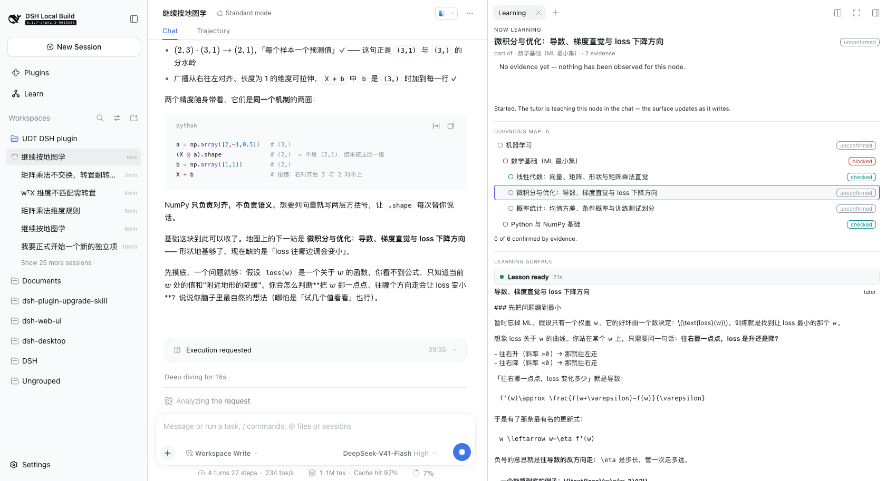
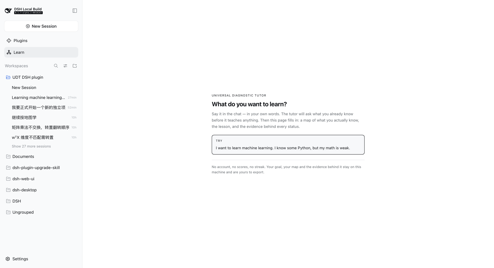
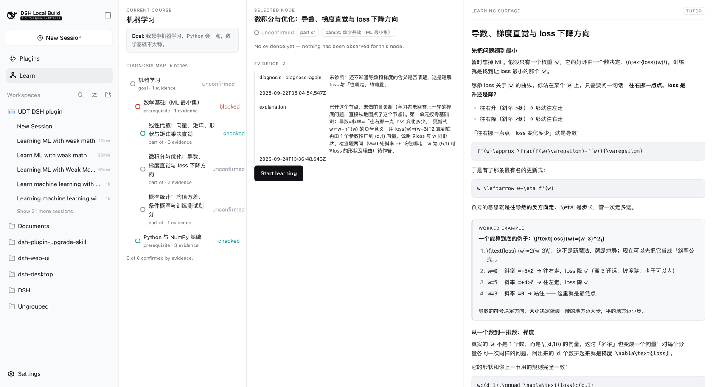
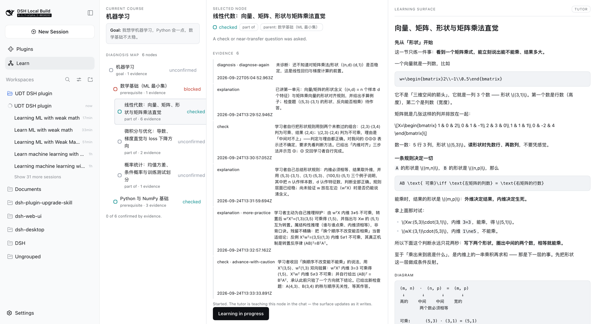
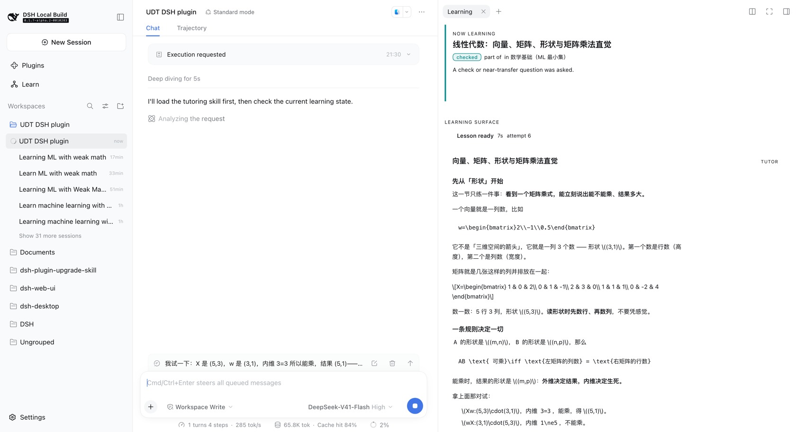
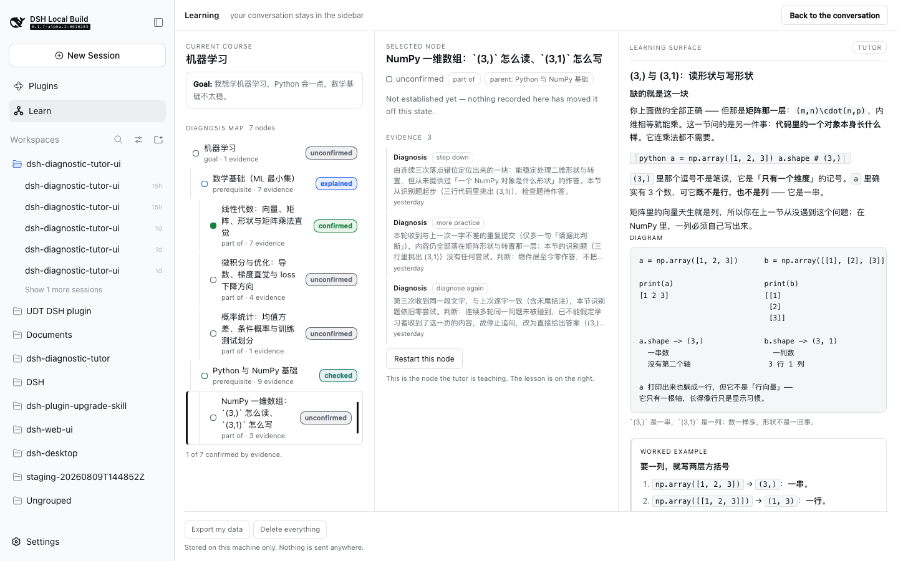
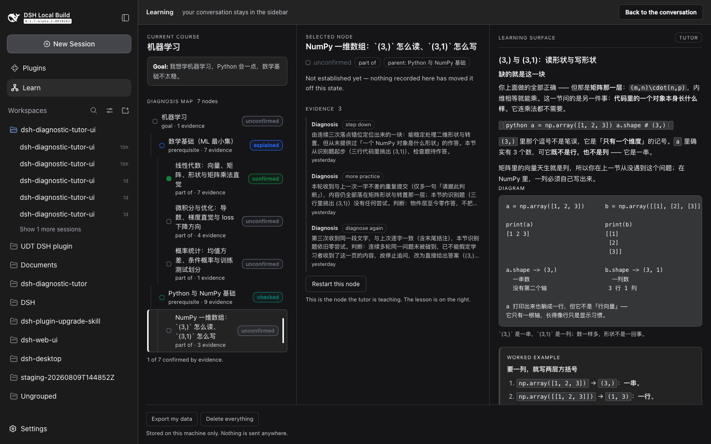
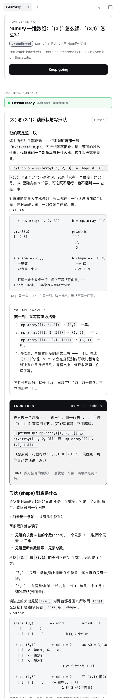
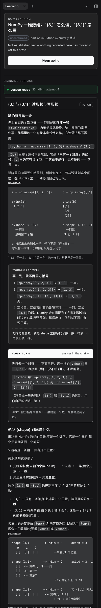

# Universal Diagnostic Tutor for DeepSeek Harness

> **From a Tutor Skill to a Learning Runtime.**

Diagnosis-first AI learning runtime for DeepSeek Harness — map what you need,
learn interactively, and move to the next best step.



<sub>The learning surface docked in the right sidebar, beside the conversation. The map, the lesson and the chat are on screen at once, so answering a check never means leaving the lesson.</sub>

## Status

`v0.1.1` is the published release. `main` also carries the learning-path work
described below, which is built and tested but **not published yet**: a saved
goal and time budget, an evidence-referenced initial assessment, versioned
course routes with per-lesson Overviews, session-scoped lesson attempts, and an
English/Simplified-Chinese interface switch.

The published release has conversation-scoped projects, focus, next steps and
handoffs, shared maps and lessons, and a docked learning surface that reports
its actual state. Install it with
`dsh plugin --profile web add dsh-diagnostic-tutor@0.1.1` — no clone, no
`pnpm install`, no build step. A checkout can be installed instead (see
[Installing a checkout](#installing-a-checkout-instead-of-the-package)).

The learning loop works end to end: a real goal in your own words, a diagnosis
map grown one node at a time, a tutor-written lesson, a check answered in the
chat, recorded evidence, and a next step the tutor chose — which the learner
presses Continue to take. The unreleased route flow adds a full plan the learner
reviews and accepts, lesson by lesson.

It is also early. The [limitations](#known-limitations) are listed rather than
left to be discovered, and nothing below claims a capability that is not there:
no PDF or document ingestion, no RAG, no flashcards, no resource libraries, no
analytics. Course routes are proposed by the teaching model, never generated by
the runtime, and a route never marks knowledge as mastered.

## Two halves, one system

The unusual thing about this project is that **the teaching and the runtime are
separate programs**, and only one of them makes decisions.

| | Owns | Where |
| --- | --- | --- |
| **[Universal Diagnostic Tutor](https://github.com/SenmuuuuW/universal-diagnostic-tutor-skill) skill**<br>= **the teaching brain** | What to teach next: diagnosis, teaching moves, pacing, when a check is passed, what the next step is | that repository (v2.1, MIT) |
| **`dsh-diagnostic-tutor`**<br>= **the learning runtime** | Where it is kept: persistent learner state, the diagnosis map, structured lessons, the UI | here |

That split is not a packaging detail. This repository contains **no teaching
logic**: no rule that says "if blocked, explain the prerequisite", no rule that
says "if wrong, give a simpler example". Those live in the skill. The runtime
stores what the tutor decided, shows it, and never decides it.

## The loop

```
Goal  →  Diagnose  →  Map  →  Learn  →  Check  →  Decide  →  Next lesson
 │                      │        │         │         │            │
 │                      │        │         │         │            └ the tutor names
 │                      │        │         │         │              the next node, with a reason
 │                      │        │         │         └ the learner answers in the chat
 │                      │        │         └ the tutor writes the lesson into the side panel
 │                      │        └ nodes appear only as diagnosis reveals them
 │                      └ the tutor asks what you actually know
 └ stated in your own words, in the chat
```

Read left to right, that is also the guarantee: **the runtime never advances on
its own.** A decision is stored with the tutor's reason, shown to the learner,
and waits to be pressed.

### The demo scenario

The screenshots below come from one scenario, run against real DeepSeek Harness
with the real skill:

> **I want to learn machine learning. I know some Python, but my math is weak.**

The tutor asks what the goal is *for* before it teaches anything, then grows a
map one diagnosis at a time.

Nothing in these images is a fixture or a mock — they are screenshots of the
running app. `demo-1` is a cold start from an empty store; the rest are the same
scenario resumed, because the clarify-then-diagnose phase costs several model
turns and a cold start to a full lesson runs to roughly fifteen minutes.

| | |
| --- | --- |
|  | **First use.** No goal yet. One question, and the sentence that answers it — no wizard, no empty dashboard. |
|  | **The diagnosis map.** Six nodes, each traceable to evidence, nested by depth. `blocked` and `checked` read at a glance; nothing is `confirmed` without a check behind it. |
|  | **A lesson.** Real headings and lists, a worked example set apart, a diagram in its own frame, and a check that hands the turn back to the learner. |
|  | **The docked surface.** The same loop in the right sidebar, with the handoff progress line (`Lesson ready 7s`) so a slow model turn reads as *working* rather than *broken*. |

---

## Why this is not just another AI tutor

Most "AI tutor" projects are a prompt wrapped around a chat box: the model
teaches, and nothing about the learner survives the conversation. Three things
are different here.

**The teaching brain is a real, separate artifact.** Diagnosis, teaching moves,
pacing and mastery judgement live in a written skill with its own protocols —
not in a system prompt this repository invented. This plugin depends on it and
refuses to duplicate it.

**State is real, and it is the learner's.** A goal, a map of what you actually
know, and a record of the evidence behind each status. Nothing is `confirmed`
without a check to back it, nothing is scored, and it is all visible and
exportable.

**The runtime does not decide.** The tutor names the next step and says why; the
runtime stores that and shows it; the learner presses Continue. There is no
path by which progress advances on its own.

Its state vocabulary is not invented here either: nodes carry the skill's own
seven status terms, and checks carry its six readiness outcomes.

### Why a map does not contradict diagnosis-first

The skill is explicit that a broad goal must **never** become a pre-expanded
curriculum or a course outline. This plugin does not produce one. Nodes appear
only as diagnosis reveals them, every node is `unconfirmed` until a check
produces evidence, and the map is reversible — new evidence moves it. What you
see is a *diagnosis map*, not a syllabus.

---

## Known limitations

Stated plainly, because each one is a real edge a user can reach.

**Math is styled, not typeset.** The tutor writes LaTeX by convention — `\(...\)`
inline, `\[...\]` display — and the runtime sets it apart in a monospace face
with its own background. It does **not** render it. Real typesetting needs a
library plus fonts and CSS, and the client bundle is a single JavaScript file
with nowhere to serve those from. This is the most visible rough edge in any
STEM lesson.

**Skill presence requires a live Agent.** The runtime checks the open
conversation's Agent scope on each overview, including its workspace. Before an
Agent exists, or while discovery is empty or incomplete, it reports `cannot tell`
and the panel stays quiet. Polling picks up later registration and Agent changes.
If lessons never appear, check the skill first.

**Storage is one document.** Every record lives in
`<dsh-home>/storages/udt.json`. It is readable, copyable and easy to export, and
it is also a single point of failure: a record that no longer matches its schema
stops the plugin from loading. Nothing is deleted when that happens, the error
names the table and the key, and removing the record by hand restores the rest —
but **export before you edit it**.

**The tutor does not always converge.** It can judge `more-practice` on the same
node several turns running, each time writing a fresh check. That is its pacing
rather than the runtime's, but it decides whether a node ever finishes and the
loop moves on.

## Compatibility

A DSH profile can resolve **more than one harness version at once** (the running
host, the shared profile fallback, and each plugin's own store). Treat this
matrix as load-bearing, not decoration.

| This plugin | Verified against DSH | Node |
| --- | --- | --- |
| `0.1.1` | `0.2.1-rc.2`, `0.2.0-rc.2` (test suite also on `0.1.7-alpha.2`) | `^22.19.0 \|\| >=24.0.0` |
| `0.1.0` | `0.1.7-alpha.2` (also composed under `0.1.5-rc.1`) | `^22.19.0 \|\| >=24.0.0` |

Rules this repository enforces mechanically:

- **Named exports only.** A `export default` plugin makes Cordis' loader prefer
  `.default` and **silently drop `inject`** — a documented DSH outage. Pinned by
  a test that fails if a default export is ever introduced.
- **`@deepseek-ai/*` is imported `type`-only**, so the compiler erases it and no
  second runtime copy can be resolved. Enforced by `verbatimModuleSyntax`, and
  verified on the built artifact (it contains zero imports).
- **No `instanceof` across package boundaries.** Take runtime objects from `ctx`.
- Peer ranges name the release lines this plugin was verified on. DSH ships
  prereleases, and npm's semver only admits a prerelease when its line is named
  in the range — so the compatibility matrix above, not the range floor, is the
  contract. Dev dependencies pin one exact cohort for the type baseline.

---

## Install

**Requirements**

| | |
| --- | --- |
| [DeepSeek Harness](https://github.com/deepseek-ai/deepseek-harness) | verified against `0.2.1-rc.2` |
| the [Universal Diagnostic Tutor](https://github.com/SenmuuuuW/universal-diagnostic-tutor-skill) skill | the teaching brain. Without it the runtime loads, records and displays state, but **no lesson is ever written** |
| Node | `^22.19.0 \|\| >=24.0.0` |

**Install the plugin**

```sh
# `web` is a shipped profile template: it is created on first use with the
# base and web-app bundles, so this works on a machine that has never run DSH.
dsh plugin --profile web add dsh-diagnostic-tutor
```

Use your own profile name in place of `web` to install into an existing one.
`--profile` is **mandatory** — without it `dsh plugin` exits non-zero, because it
is a thin pnpm forwarder that needs a profile to forward into.

For a new profile that is not one of the shipped names, create it from a
template first:

```sh
dsh --profile mine --from-default-profile web --dump-config >/dev/null
dsh plugin --profile mine add dsh-diagnostic-tutor
```

**Install the skill**

The skill is a separate project and is not bundled here — install it where your
DSH agent looks for skills (see its README). The runtime works with or without
it; without it, nothing writes a lesson. Note that the runtime cannot always
*detect* it: see [Known limitations](#known-limitations).

**Verify**

```sh
# The plugin should appear in the merged tree, as an insert row.
dsh --profile web --dump-config | grep -A2 dsh-diagnostic-tutor
```

Then start the profile and look for **Learn** in the sidebar:

```sh
dsh web --port 8399 --no-open
```

A `--dump-config` entry only proves a loader row exists — it is not proof the
plugin runs. Opening the panel is: a first run shows *What do you want to
learn?*.

**Install from a tarball** — the same command with a path:

```sh
npm pack
dsh plugin --profile web add "$PWD/dsh-diagnostic-tutor-0.1.1.tgz"
```

**What gets installed is prebuilt.** The package ships `lib/` — the host half
and the browser bundle — plus `cordis.patch.yml`. No build step, no clone, no
`pnpm install`, and no `link:` dependency. The only runtime dependency is `zod`;
every `@deepseek-ai/*` package is a **peer**, resolved from the harness itself,
so a second copy of the DSH runtime is never pulled in.

---

## Learner state and the diagnosis map

State lives in one Cordis **storage domain** (`udt`, version 1) over the
official `storageDomain` seam. The profile chooses the medium — the standard
profiles route it through `dsh-storage-json` under `dshHomePath('storages')` —
so this plugin never hardcodes a path.

With the json backend you get exactly one document, `<storage root>/udt.json`
(`~/.dsh/storages/udt.json` for a default install):

```json
{
  "unit": { "name": "udt", "version": 1 },
  "global": { "initializedAt": "…", "updatedAt": "…", "activeCourseId": "…" },
  "tables": { "courses": { "…": {} }, "nodes": { "…": {} } }
}
```

| Slot | Holds |
| --- | --- |
| `global` | the learner singleton — preferences, `initializedAt`, and the legacy shared `activeCourseId` marker |
| `tables.courses` | one record per learning goal, in the learner's own words |
| `tables.nodes` | the diagnosis map: `id`, `courseId`, `title`, `parentId?`, `relation`, `state`, `evidence[]` |

Courses, maps, lessons and evidence are shared by the learner's conversations.
Project selection, focus, next step and handoff belong to one conversation,
identified by its session ID. The legacy `activeCourseId` remains in storage for
compatibility; it does not select a project for a conversation. A fresh
conversation starts with the library, even when historical projects exist.

| Conversation selection | Project binding |
| --- | --- |
| `none` | A new goal, or a validated write explicitly naming a course or node in this conversation, may select its project. Reading shared data does not select it. |
| `new` | The learner pressed **Start something new**. Only a new goal created here may bind; historical map or lesson writes leave this choice intact. |
| `project` | The selected course is the default for tools. Creating another goal does not replace it; writes to another course require selecting that course first. |

`udt_status` reports this conversation's `selection` and, only for `project`,
its `courseId`. Goal, map and lesson writes return `projectAdopted` and
`projectBinding`: `adopted`, `already-selected`, `not-selected`, or
`missing-session-id`. A choice made while a write is pending takes precedence
over that write's adoption. Without a reliable session ID, status reports
`sessionAvailable: false`; explicit shared writes can still be stored, but their
result is `missing-session-id` and they claim no conversation binding.

Two deliberate rules:

- **zod is the contract.** Every record is validated at the durable boundary, so
  a hand-edited or corrupt document fails loudly instead of entering memory.
- **No scores, ever.** There is no field for points, grades or percentages —
  the skill forbids turning mastery into a score, and a test asserts that no
  such key exists anywhere in the persisted document.

Records are never mutated in place; writes go through `put`/`set` on one
per-domain write chain, so concurrent writers cannot interleave.

### How the map is kept from becoming a syllabus

The rules are enforced in `src/diagnosis.ts` as pure functions, so no tool can
route around them:

- a node is **born `unconfirmed`**, and stays there without evidence;
- `confirmed` requires a **`check` or `transfer`** evidence entry. Explanation
  or practice alone never confirms — the skill is explicit that "explanation
  alone and one lucky answer never confirm readiness";
- a **goal node can never be confirmed**: it is the frame of the map, not a
  claim about the learner;
- every non-goal node must attach to a **parent that already exists** in the
  same course, and there are no cycles — so the map grows outward from what has
  been diagnosed, one step at a time;
- **at most 8 nodes per call and 40 per course.** A single call cannot plant a
  term's worth of material;
- `relation` is `goal | part-of | prerequisite | related`. There is deliberately
  no `next-in-course`, because nothing in this runtime knows a teaching order.

### Tools

Six, and none of them decides anything about teaching.

| Tool | Does |
| --- | --- |
| `udt_status` | reports shared goals and counts, plus this conversation's selection, focus and pending next step |
| `udt_goal_create` | records a goal and plants only the map root; may also select it for this conversation |
| `udt_map_get` | reads the selected project's map, or an explicitly named shared course, with each node's relation, state and evidence |
| `udt_map_update` | `add-nodes` · `set-state` · `add-evidence` |
| `udt_lesson_update` | writes teaching into the learning surface as blocks |
| `udt_decide_next` | records where the learner should go next, and why |

The division is the architecture: the tutor decides **what** to teach, when to
check, and what an answer showed; the runtime decides **what may be stored** and
renders it. There is no branch anywhere in this repository that says "if blocked
then explain the prerequisite" — that is the skill's call, made in the chat.

### The loop

```
press Start learning
   → focus recorded (courseId, nodeId, startedAt, status)
   → the tutor is woken in that conversation with the node named
   → the tutor teaches into the surface via udt_lesson_update
   → the learner answers the check in the chat
   → the tutor judges, records evidence via udt_map_update, decides the next move
   → the panel follows
   → the tutor decides the next step with udt_decide_next
   → the panel shows the recommendation and its reason
   → the learner presses Continue, and the next node begins
```

### The decision

`action` is the skill's six readiness outcomes, reused rather than re-invented:
the words for "what this concept showed" and "where that sends the learner" are
the same words. The runtime only needs one structural fact about each — whether
it names a target:

| outcome | target | means |
| --- | --- | --- |
| `advance` / `advance-with-caution` | required | move there |
| `step-down` | required | the blocker; usually a prerequisite |
| `review-first` | optional | go back, or review here |
| `more-practice` / `diagnose-again` | forbidden | stay here |

A move ends the focus and stamps `endedAt`; staying leaves it open. Nothing
moves on its own — the learner reads the reason and presses Continue.

### The wait, measured

Moving to a node is not instant, so the wait is a **persisted record** keyed by
target node — which makes it idempotent, refresh-proof, restart-proof and
retryable — and it carries a timestamp per stage:

```
requestedAt → focusRecordedAt → promptedAt → firstActivityAt → lessonAt → observedAt
```

The same record is the progress line (`focus recorded` → `tutor requested` →
`tutor working` → `lesson ready`, with elapsed seconds) and the measurement. A
real run against DSH 0.1.6-alpha.2 and the real skill:

| stage | when |
| --- | --- |
| focus persisted | 0.0s |
| followup accepted | 0.0s |
| first tutor activity | 1.0s |
| lesson written | 26.1s |
| UI observed | 26.1s |

**The plugin costs about a second; the rest is the model writing.** A stall is
derived from the record rather than stored, and retrying never touches the
focus — a timeout is a statement about the wait, not about where the learner is.

`Start learning` is a **user-role turn attributed to this plugin**, not injected
context: `agent.inject()` would add model-visible context without waking an idle
agent, so nothing would happen until the learner typed. Opening a turn is what
the button means.

### Two surfaces, one state

| Surface | Where | For |
| --- | --- | --- |
| **Learning map** | the main column (`main`, key `diagnostic-tutor-map`) | browsing — course route, every lesson Overview, knowledge & evidence |
| **Current lesson** | the right sidebar tab, beside the chat | the lesson itself — teaching units, and checks answered in the chat |

One page for browsing, one surface for learning. The page never starts a lesson;
the tab never decides what to teach. Both read the same `useLearning` state and
the same path client, so they cannot disagree about what is focused, accepted or
written. **Open current lesson** on the map returns to the conversation with the
lesson tab open in the same step.

The container for the main column is the map page. A full-page lesson panel used
to exist as a second main destination; it was removed so the same lesson is not
offered in two places. The standalone full-page component is still used by the
preview and the tests, but the plugin does not register it.

### Teaching-brain detection

Each overview asks the platform's own Agent and Skill registries whether the
Universal Diagnostic Tutor skill is available in the requesting session's live
Agent scope and cwd. No path is hardcoded, no skill root is assumed, and nothing
is copied. Missing services and incomplete discovery return an inconclusive
status; complete scoped discovery can establish presence or absence.

Compatibility is probed by **capability**, not by a version string: the skill's
maintenance contract permits only `name` and `description` in frontmatter, so
it cannot declare a version. The result carries a short content digest as a
version hint.

Paths, fingerprints and compatibility details stay **internal**, absent from
every tool output and overview. The overview exposes only availability. The skill
forbids naming its files, versions or repository in learner-facing text.

### How the two halves agree

The skill's guardrails say mastery tracking must never become "scores,
databases, hidden memory, or a curriculum roadmap", while this runtime
deliberately persists state and renders a map.

Until `v0.0.8` that tension was bridged from this side: a short system-prompt
section explained the runtime's storage semantics to the teaching brain. UDT
v2.1's `learning_runtime_contract.md` now states all of it in the skill's own
words — what a runtime may hold, when a decision is recorded, and that a turn
which judged an answer is *not finished* until the next step is recorded — so
the bridge was **deleted rather than kept as a second voice**. The plugin got
better at it, which is the evidence it belonged upstream.

## The page and the lesson surface

The browser half registers three things: the **Learning map** icon in the
sidebar (`sidebar.panellist`, a `list`), the page it opens (`main`, a `keyed`
slot, key `diagnostic-tutor-map`), and the **Current lesson** tab in the right
sidebar (a tab type plus its body and title). The map's sidebar `id` and its
`main` key come from one constant — a drift between them would leave the icon
opening nothing.

The page has two tabs: **Course route** (the versioned plan, route canvas,
ordered lesson list and every Overview) and **Knowledge & evidence** (the
diagnosis map and its recorded observations). Neither one teaches: they show
stored state.

The route tab shows one stage at a time. A progress bar names the four stages —
goal & time, initial diagnosis, route, learning — and only the current stage's
cards are expanded. Before a goal is saved the wizard owns the page; while the
tutor is asking diagnostic questions the page says **Initial diagnosis in
progress** and offers a way back to the conversation; route versions appear only
after the diagnosis is complete or skipped; once accepted, the page leads with
the route canvas. Completed diagnosis details and route settings stay reachable
in folded sections, and the effort card only appears when the estimate conflicts
with the saved budget.

The lesson lives in the docked tab, where the conversation is still on screen.
That is what makes the check loop work without leaving the lesson. The sidebar
action **Learn** opens that tab and never takes over the main column; the map's
**Open current lesson** button returns to the conversation and opens the same
tab.

```
sidebar Learn ─────────────▶ Current lesson (right sidebar)
sidebar Learning map ──────▶ Learning map (main column: route | knowledge)

Open current lesson ◀────── returns to chat + lesson tab
```

A full-page lesson panel used to exist as a second main destination. It was
removed: one page for browsing, one surface for learning, and the conversation
keeps the main column.

### Learning Blocks

A block is `{ id, type, content, metadata? }`. The **schema is host-side**
(zod-validated at the durable boundary) and the **renderers are browser-side**,
keyed by `type`:

| Type | Content |
| --- | --- |
| `text` | `md` — markdown, with the skill's `\(...\)` math convention |
| `example` | `title`, `steps[]`, `takeaway?` |
| `diagram` | `format` (`ascii` \| `mermaid`), `spec`, `caption?` |
| `check` | `prompt`, `expect?`, `hint?` — the stop-and-wait surface |

Adding Formula, Code, Comparison, Practice or Resource later means adding one
registry entry, never rewriting the lesson renderer. An **unknown type renders a
readable placeholder** rather than throwing, so a lesson authored by a newer
host still renders here.

### Browser API

Three calls, at `/diagnostic-tutor/api`:

| Route | Returns |
| --- | --- |
| `GET /overview` | the current course and its whole map (`course: null` on a first run) |
| `GET /node?id=` | one node with its evidence, parent and children |
| `POST /lesson {nodeId}` | the prototype lesson, built once and reused after that |

Every request passes a **trust fence**: a bare `ctx.webServer.register()` route
inherits no authentication, so the route checks that the request arrived at a
loopback `Host`, from a loopback `Origin`, and is not marked cross-site. Anything
else gets `403` and no body. The browser receives **views only** — no storage
path, no domain handle, no raw record.

### Interface language

Every plugin surface ships copy in **English and Simplified Chinese**: the
Learning map page, the course route, the docked Current-lesson tab, the
standalone full-page panel used by the preview and tests, and the shared
next-step card, handoff line and welcome row. The sidebar Learn action and its
missing-conversation explanation switch too. A toggle in the map header (and in
the lesson surfaces) changes the copy in place; the language is saved on the
learner profile (`preferredLanguage`, via `GET /preferences` and
`POST /preferences/language`), so it survives a restart and applies to every
conversation. The choice applies immediately and is saved in the background: a
failed request keeps the local choice rather than flipping the UI back.

It is copy, not content: the tutor's teaching, the learner's goal text, lesson
overviews, node titles and recorded evidence are never machine-translated, and
the model is not instructed to change language by the toggle. Three things stay
outside the switch: the **Learning map** sidebar label (registered once when the
plugin loads, so it cannot follow an in-place change), server/model error text
and dynamic handoff details as generated, and the development preview's own
toolbar.

## Preview

The panel takes its API as a prop, so the UI runs with no DSH and no agent:

```sh
pnpm build && pnpm preview     # then open the printed URL
```

`preview/index.html` loads the **real built bundle** through a
`__ModuleLoader__` shim over `preview/fixture.js`, which models a learner who
said "I want to learn machine learning" with shaky maths:

```
Machine Learning            [goal, unconfirmed]
├─ Math Foundations         [prerequisite, blocked]
│  ├─ Linear Algebra        [part-of, unconfirmed]
│  ├─ Calculus              [part-of, unconfirmed]
│  └─ Probability           [part-of, unconfirmed]
└─ Python                   [prerequisite, unconfirmed]
```

Two query parameters reach the states that are otherwise awkward to produce on
demand — `?scenario=` (`first-use`, `map`, `handoff`, `next`, `stay`, `noskill`,
`long`, `scroll`, `library`, `new`, `showcase`, `curriculum`, `path-draft`,
`path-setup`, `path-assessment`) and `?surface=tab` / `?surface=map` for the
docked right-sidebar tab and the standalone map page. The scenario switch is in
the page's toolbar, and the theme toggle sets the same
`body[data-ds-dark-theme]` attribute DSH does. The page carries the real DSH
design tokens for the same reason: with hardcoded fallbacks in their place, a
token that resolves to near-white in dark mode looks perfectly fine locally.

To capture the panel from a *live* profile instead:

```sh
pnpm screenshot "<dsh-url-with-token>" preview/dsh-ui.png
```

### Auditing the presentation

```sh
pnpm preview                                                     # in one shell
pnpm audit:ui http://127.0.0.1:8391/?scenario=next                # in another
pnpm audit:ui "<dsh-url-with-token>" /tmp/audit --surface=tab
pnpm check:scroll http://127.0.0.1:8391/ /tmp/udt-scroll-check
```

The scroll regression requires local Chrome and runs against the built bundle.
The preview uses a clipped, fixed-height slot like DSH, so the whole document
cannot scroll to mask an unscrollable plugin. The check sends real wheel events
and verifies bottom content remains visible in the tab, expanded tab, stacked
panel, all three wide-panel panes, and long library/welcome views, in both themes.
Only fixture data is used; no live learner state is changed. The ordinary visual
audit alone does **not** verify scrolling.

The visual audit measures, at each width this project targets and in both themes: the contrast
of every control's own text against its own fill, class names in the DOM that no
rule matches, how many controls carry primary weight in one view, tap targets
under 28px, type under 10.5px, and anything spilling or clipped. It prints a
table, writes `findings.json`, and saves screenshots — it does not fail the run,
so a human can disagree with it.

That is not a substitute for looking. It is what makes looking affordable: the
docked tab's invisible primary button and the dark-mode 1.05:1 controls were
both found by it, in a live profile, in seconds.

What the surfaces look like now, captured from a live profile:

| | light | dark |
| --- | --- | --- |
| standalone panel (preview/tests only) |  |  |
| docked tab |  |  |

These captures predate the current layout: the standalone full-page panel is no
longer a product surface. Today the Learning map page owns the main column and
the Current lesson tab holds the teaching.

## Development

```sh
pnpm install
pnpm typecheck   # tsc --noEmit  (host and client)
pnpm test        # unit, guard, DOM, render, real composition
pnpm build       # tsc -> lib/ (host) + tsdown -> lib/client.js
```

### Installing a checkout instead of the package

Working on the plugin itself, rather than using it:

```sh
pnpm install && pnpm build

# Use an absolute path. `dsh plugin` runs pnpm inside the profile directory, so
# a relative path would resolve against the profile, not your checkout.
dsh plugin --profile <profile> add "$PWD"
```

The profile links the directory, so `pnpm build` is enough to pick up a change.
This is the only path that needs a clone and a build — the published package
ships prebuilt `lib/`.

`tests/harness.ts` mounts the **same storage stack the standard profiles use**
(`systemPrompt` → `tools`, and `storage` → `storage-json` → `storage-domain`)
over a temporary root. Persistence tests therefore exercise a real
serialize → file → reparse → validate round trip rather than a fake, and
`--dump-config` is never mistaken for proof that a plugin loads: that only
shows a loader row exists.

## Roadmap

| Version | Ships |
| --- | --- |
| `v0.0.1` | installable bundle, plugin loads, guard + composition tests |
| `v0.0.2` | `udt` storage domain, learner round-trip, `udt_status` tool |
| `v0.0.3` | teaching-brain detection, `udt_goal_create`, the diagnosis map (`udt_map_get` / `udt_map_update`) |
| `v0.0.4` | the client half: slot-mounted panel, clickable map, node detail, Learning Blocks, browser API |
| `v0.0.5` | the loop: learning focus, tutor-written lessons, check → evidence → state, live panel |
| `v0.0.6` | the learning surface docks beside the chat; both surfaces share one state |
| `v0.0.7` | the tutor decides the next step; focus lifecycle; NEXT BEST STEP card |
| `v0.0.8` | handoff record, progress line, retry, and the latency measured |
| `v0.0.9` | DSH 0.1.7 compatibility, the first real A → B, and product polish |
| `v0.0.10` | export and delete your data |
| `v0.0.11` | storage layout tested; `single` kept, with the reason |
| `v0.1.0-rc.1` | packaged install, no clone or build required |
| `v0.1.0` | first stable release, installable from npm |
| `v0.1.1` | **published** — packaged release with the docked learning surface |
| `main` (unreleased) | learning-path flow: goal/time brief, evidence-referenced assessment, versioned course routes with per-lesson Overviews, session-scoped attempts and teaching snapshots, English/Simplified-Chinese interface, one page + one lesson surface |
| next | settings, math typesetting, automatic replan suggestions (the tutor already proposes revisions on request; no runtime auto-replan) |

## Trust

DSH does not sandbox plugin code: an installed plugin runs in-process with your
privileges, and a bare `ctx.webServer.register()` route inherits no
authentication. This plugin's commitments:

- reads and writes only its own storage domain;
- serves its browser half only from loopback-fenced routes it checks itself;
- makes no outbound network requests;
- writes no files outside the harness's own storage;
- keeps learner state visible, exportable and deletable — never hidden memory.
  **Export my data** writes one self-describing JSON file; **Delete everything**
  removes it, behind a second click, irreversibly. An undo would mean keeping a
  copy of exactly what was asked to be deleted.

### Without the teaching brain

Install the plugin without the skill and nothing breaks: the plugin loads, the
panel opens, the map and the lesson surface render, and `GET /export` and
`POST /reset` work. What does not happen is teaching — nothing writes a lesson,
because nothing is making teaching decisions.

**Availability is checked for the conversation you have open.** On every
`GET /overview?sessionId=…`, the plugin resolves that session's live Agent from
DSH's Agent registry and asks the Skill registry for a complete snapshot using
`{ scope: agent, cwd: agent.session.header.cwd }`. A root catalog containing
Office skills cannot establish whether that Agent has a tutor. Services are
resolved for each request, so delayed registration, removal and preset changes
are picked up by the panel's existing polling. The runtime reports three states:

| `teachingBrain` | meaning | what the panel does |
| --- | --- | --- |
| `true` | found and model-invocable in the live Agent scope | nothing |
| `false` | unavailable after complete scoped discovery with entries | says a tutor is needed |
| `null` | no live Agent, empty/incomplete discovery, or unsupported/unavailable service | says nothing |

An earlier revision treated "not in my catalog" as "not installed" and showed a
notice on that basis. In a web profile that was a confident, wrong answer — the
notice would have appeared with the skill installed and in use. It only fires on
`false` now.

The lesson in the meantime is the honest one: if lessons never appear, check
that the skill is installed for your agent before suspecting the runtime.

### Where your data lives, and what happens when it breaks

Everything is stored **locally**, in one JSON document:
`<dsh-home>/storages/udt.json`. Nothing is sent anywhere, there is no account,
and the file is plain enough to read.

**Export before you edit it.** Hand-editing is not blocked, but every record is
validated against its schema when the store opens, so one record that no longer
matches stops the plugin from loading.

**What is true today.** A damaged record fails the open, is reported with the
table and key that failed, and is **not deleted**. The plugin loads inert rather
than failing the rest of the profile, and removing the offending record restores
everything else. `GET /export` on a healthy store is the way to make sure you
still have your data.

**What is not true, and is not claimed.** The platform has a record-recovery
option, `invalidRecords: 'backup-and-skip'`, which moves a bad record aside and
opens without it. This plugin **does not declare it**, because under the
`single` layout the platform would ignore it: the option only runs when the
store can move a *per-record* document aside, and here one document holds
everything. Declaring it would read like a recovery guarantee while doing
nothing, which is worse than not having it. So a bad record is **not** backed
up and skipped, and this README says so rather than implying a recovery ability
that does not run.

#### Storage architecture is frozen for v0.1.0

Decided, and not revisited before the first release: `single` layout, no
per-record, no id migration. The recovery strategy is the one described above —
precise errors, nothing destroyed, export/reset, hand repair.

#### Why not `per-record`

Switching the layout would make that option live, so it was tested against the
platform rather than assumed. Migration is fine: a real store's 1 course,
6 nodes, 3 lessons, 1 focus and 2 decisions were all seeded into per-record
documents, with the original file left untouched.

Writing is not. In `per-record`, each record key becomes a path segment and must
match `[a-zA-Z0-9_-]+`:

```
unit 'udt': per-record key '机器学习' is not path-safe (must match /^[a-zA-Z0-9_-]+$/)
```

The `:` alone is enough — `ml:math` is rejected too. Every node, lesson and
decision id in this plugin is `<courseId>:<slug>`, so the layout would leave the
runtime able to read and unable to write. The same applies to course ids, which
come from the learner's own words and are frequently not ASCII.

Making the ids path-safe means a referential migration across courses, nodes,
lessons, focus and decisions, plus changing the ids the tutor passes back to the
tools. That is worth doing deliberately — not as a side effect of flipping a
layout flag. Until then, `single` is the honest choice, and its limit is the one
stated above.

## License

MIT. The Universal Diagnostic Tutor skill is a separate MIT project by the same
author and is not vendored here.

Planning and architecture research for this project live in
[`docs/planning/`](docs/planning/).
