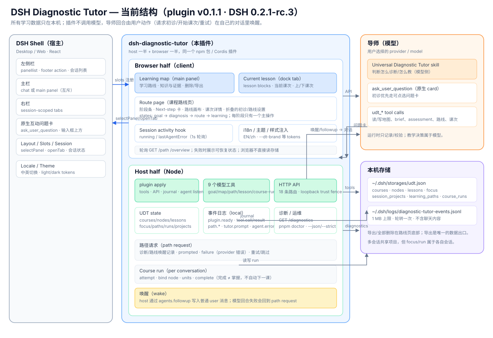
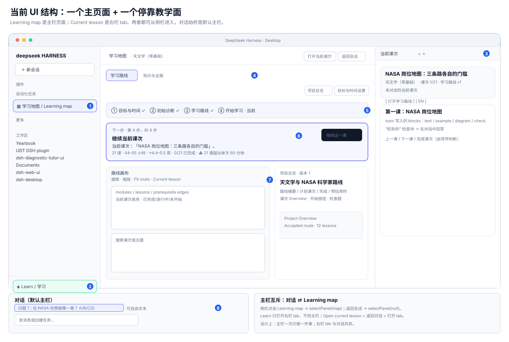
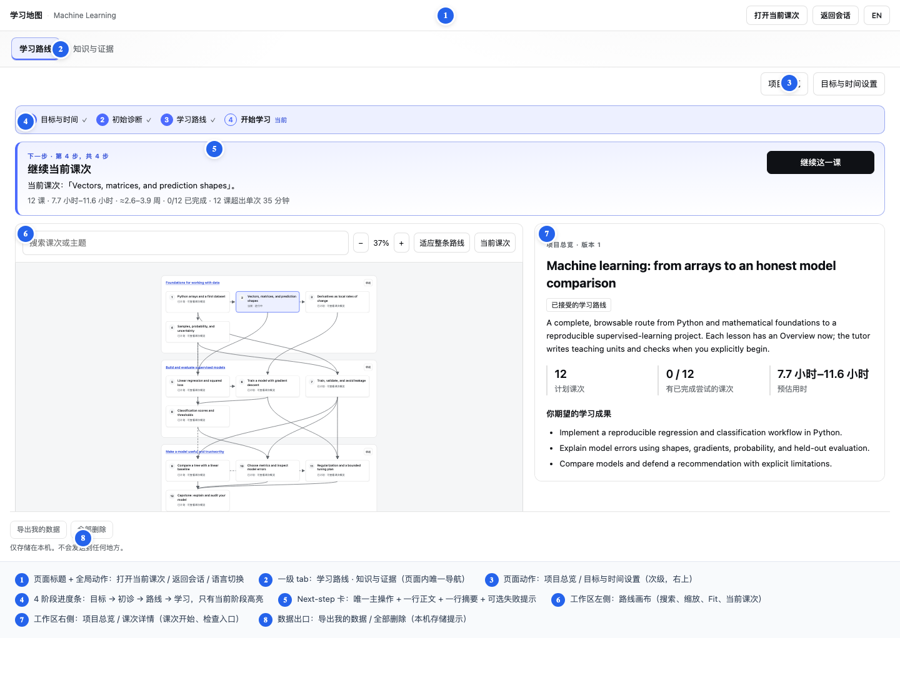
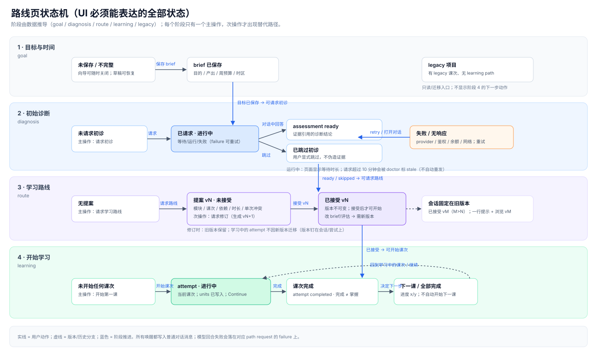
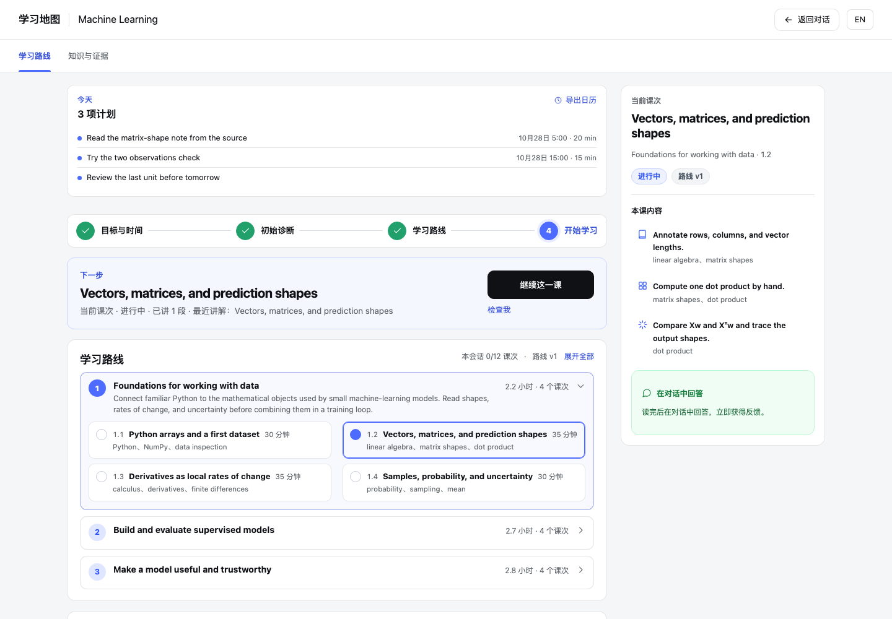
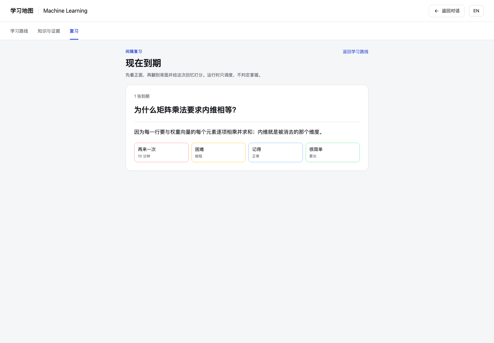

# DSH Diagnostic Tutor — 当前 UI 基线（交给最终 UI 设计用）

> 版本：plugin `0.1.1` · DSH `0.2.1-rc.3` · Phase 1 分支 `feat/phase1-content-sources`
> 这份文档只描述**现在真实存在的界面、状态和交互约束**，不代表最终视觉方向。
> 目标：让你在不猜产品逻辑的前提下，重画最终 UI 样板。

---

## 0. 文件索引

| 文件 | 用途 |
| --- | --- |
| `architecture.svg` | 系统结构图：DSH shell、插件 host/client、导师模型、本机存储 |
| `ui-shell.svg` | 界面结构图：左侧栏 / 主栏 / 右栏、两个主要 surface、入口 |
| `route-states.svg` | 路线页状态机：四个阶段 + 失败/跳过/版本分支 |
| `route-page-annotated.png` | 当前路线页（学习阶段）带编号的 UI 图 |
| `screens/01-map-library.png` | 主栏：未打开项目 / 项目列表 |
| `screens/02-route-goal.png` | 路线页：目标与时间（向导关闭） |
| `screens/03-route-diagnosis.png` | 路线页：初诊未请求 |
| `screens/04-route-diagnosis-waiting.png` | 路线页：初诊等待中 |
| `screens/05-route-request.png` | 路线页：已跳过初诊、等待请求路线 |
| `screens/06-route-proposal.png` | 路线页：路线提案已生成、未接受 |
| `screens/07-route-learning.png` | 路线页：学习阶段（当前主界面，浅色） |
| `screens/08-route-learning-dark.png` | 同上，深色 |
| `screens/09-knowledge-map.png` | 知识与证据 tab |
| `screens/10-current-lesson-tab.png` | 右栏：当前课次 tab（浅色） |
| `screens/11-current-lesson-tab-dark.png` | 同上，深色 |
| `screens/12-first-use.png` | 主栏：没有任何项目时的 empty state |
| `index.html` | 以上图的画廊视图（双击用浏览器打开） |

所有截图来自 `scripts/preview.mjs` 的 fixture 数据，**不含真实用户内容**；截图为 1440×900、中文界面。

---

## 1. 一句话现状

插件在 DSH 里提供两个 surface：

1. **Learning map** —— 一个主栏页面（和对话互斥），负责「目标 → 初诊 → 路线 → 学习」全部项目状态。
2. **Current lesson** —— 一个右栏停靠 tab，负责「当前课次」的教学内容与检查。

导师仍是普通对话里的模型；所有教学、诊断、路线生成、判断都由模型通过 9 个 `udt_*` 工具写入本机状态；UI 只负责展示、引导和发起请求。

---

## 2. 系统结构



### 2.1 两层职责

| 层 | 位置 | 负责 | 不负责 |
| --- | --- | --- | --- |
| Browser half | 浏览器 bundle | 渲染主页面/右栏 tab、轮询数据、发起请求、展示错误/等待、i18n/主题 | 不直接读写本机文件、不调模型 |
| Host half | Node 插件 | `apply` 注册、18 个模型工具、26 条本地 HTTP 路由、UDT state、journal、diagnostics | 不做教学决策、不自己调用模型（只通过用户动作唤醒） |

### 2.2 数据与运行

- 存储：`<dsh-home>/storages/udt.json`，表：`courses`、`nodes`、`lessons`、`focus`、`next_steps`、`handoffs`、`session_projects`、`learning_paths`、`course_runs`。
- 日志：`<dsh-home>/logs/diagnostic-tutor-events.jsonl`，1 MB 上限、轮转一次、事件不含聊天/目标/证据内容。
- 运行：`GET /diagnostic-tutor/api/diagnostics` + `pnpm doctor`（`--json` / `--strict`）。
- 唤醒：所有「请导师开工」都要写一条**普通用户消息**到当前对话（`agents.followup`）；模型失败时把 `failure` 写回对应的 path request。

### 2.3 只有模型能做的事

- 写 brief / assessment / curriculum / map 节点 / 课次内容。
- 判断「课次完成、下一步学什么」；**完成 ≠ 掌握**，UI 不会自动开始下一课。
- 决定是否使用 `ask_user_question` 渲染可点选问题卡。

UI 设计不能把上述逻辑收进按钮里；按钮只能**请求**模型做，或展示模型已写入的状态。

---

## 3. 界面结构



### 3.1 Surface 清单

| # | Surface | 位置 | 打开方式 | 是否抢主栏 |
| --- | --- | --- | --- | --- |
| 1 | Learning map | 主栏 main panel | 侧栏「学习地图 / Learning map」 | 是（替换对话） |
| 2 | Course route | Learning map 内的默认 tab | 打开 Learning map | — |
| 3 | Knowledge & evidence | Learning map 的第二个 tab | 页面内 tab | — |
| 4 | Current lesson | 右栏 dock tab | 侧栏底部「Learn」、路线页「打开当前课次」、下一课按钮 | 否（与对话共存） |
| 5 | 对话 + 原生问题卡 | 主栏默认 | 默认就是对话 | — |

### 3.2 入口关系

```
侧栏 Learning map ──selectPanel(map)──► 主栏 Learning map
侧栏 Learn ─────────openTab(lesson)────► 右栏 Current lesson（主栏不变）
路线页「打开当前课次」──返回对话 + openTab(lesson)
路线页「继续这一课」──同上
浏览器刷新/切项目──session_projects 决定恢复哪个项目
```

页面标题栏始终显示「学习地图 · 项目名」，并有两个全局动作：**打开当前课次**、**返回会话**，以及语言切换。

---

## 4. 路线页解剖（当前主界面）



| # | 区域 | 内容 | 设计注意 |
| --- | --- | --- | --- |
| 1 | 页面标题 | 学习地图 · 项目名；打开当前课次 / 返回会话 / EN | 项目名不在页面内部重复 |
| 2 | 一级 tab | 学习路线 / 知识与证据 | 页面内唯一导航，不再加二级 tab |
| 3 | 页面动作 | 项目总览 / 目标与时间设置 | 次级，右上；失败/设置打开后不要抢主操作 |
| 4 | 阶段条 | 目标与时间 → 初始诊断 → 学习路线 → 开始学习 | 只有当前阶段高亮；完成态 ✓；未开始不写「未开始」 |
| 5 | Next-step | 唯一主操作 + 一行正文 + 一行紧凑摘要 + 失败提示 | 整个页面最重要的组件：一屏只允许一个「下一步」 |
| 6 | 路线画布 | 模块/课次/依赖边、搜索、缩放、Fit、当前课次 | 可浏览但不可直接改；点击只负责选中/浏览 |
| 7 | 项目总览/详情 | 路线标题、摘要、统计、课次 Overview、开始/检查入口 | 与 Next-step 有信息重叠，是当前主要「文字疲劳」来源 |
| 8 | 数据出口 | 导出我的数据 / 全部删除 | 本机存储提示；删除不可逆，需要极强确认 |

### 4.1 当前页面的信息层级

```
页面标题（谁）
  └─ 一级 tab（看什么：路线 vs 知识）
      └─ 阶段条（到哪一步）
          └─ Next-step（现在做什么）   ← 唯一主操作
              └─ 工作区（路线画布 + 详情）  ← 探索性内容
                  └─ 折叠区（初诊记录 / 路线版本与设置 / 数据出口）
```

---

## 5. 状态清单（UI 必须设计到的全部状态）

### 5.1 Learning map 主页面

| 状态 | 触发 | 当前表现 | 参考图 |
| --- | --- | --- | --- |
| 未打开项目 / 项目列表 | 没有 session project | 空态图标 + 「还没有可绘制的内容」+ 项目列表 | 01 |
| 完全没有项目 | 新用户 | empty state + 对话引导 | 12 |
| legacy 项目 | 有旧版课次、无 learning path | 只读浏览 + 迁移/继续入口 | — |
| 目标阶段 | 有项目，无完整 brief | 向导（可关闭）+ Next-step 让保存 | 02 |
| 初诊未请求 | brief 已保存 | 初诊卡 + Next-step「请求初诊」/「跳过」 | 03 |
| 初诊等待/运行 | 已请求，导师未写回 | 请求已发送提示 + 等待时长 + 跳转对话 | 04 |
| 初诊失败 | provider/网络/鉴权等 | 错误提示 + 分类建议 + 重试/打开对话 | — |
| 路线未请求 | assessment ready 或已跳过 | Next-step「请求学习路线」 | 05 |
| 提案已生成 | 模型写入 curriculum，acceptedVersion=null | 版本选择 + 接受 + 请求修订 + 路线预算 | 06 |
| 学习进行中 | acceptedVersion 存在 + 有 activeAttempt | Next-step「继续当前课次」+ 工作区 | 07/08 |
| 下一课 | 当前课次已完成，仍有未完成课次 | Next-step「开始下一课」+ `x/y done` | — |
| 路线完成 | 所有 item 都有 completed attempt | Next-step「这条路线已完成」+ 返回对话 | — |
| 版本冲突 | accepted vM > 会话固定 vN | 一行提示「本对话仍在版本 N」+ 浏览 vM | — |
| 只读/浏览 | 无 session 或无执行权 | 「Browsing only」提示；请求/开始禁用 | — |

### 5.2 Current lesson 右栏 tab

| 状态 | 表现 | 参考图 |
| --- | --- | --- |
| 无尝试 | 空态 + 打开学习路线 | — |
| 进行中 | 课次标题、项目、`x/y`、route 版本、blocks、检查块 | 10/11 |
| 完成态 | 完成提示；是否下一课由导师决定 | — |
| 空/加载失败 | 可恢复错误 + 重试 | — |

课次内容块有十种：`text`、`example`、`diagram`、`check`、`formula`、`code`、`quiz`、`flashcard`、`resource`、`comparison`。**check 仍没有输入框**；quiz/闪卡可在 tab 内作答，运行时只记录，不判分。

### 5.3 知识与证据 tab

节点状态：`unconfirmed` / `explained` / `practiced` / `checked` / `weak` / `blocked` / `confirmed`；每个节点有证据列表。只有带 check/transfer 证据的节点才能 `confirmed`。

### 5.4 对话里的原生问题卡（不是插件绘制）

- 由 DSH 的 `ask_user_question` 工具触发，出现在输入框上方。
- 支持单选、多选、自由文本；回答进入对话上下文。
- 初诊提示词要求导师优先用它；但模型可能仍然把问题写成普通文本。
- 设计时必须同时考虑两种现实：**有点选卡** / **纯文本问答**。

---

## 6. 路线页状态机



### 6.1 阶段推导

| stage | 条件 |
| --- | --- |
| `goal` | brief 不完整 |
| `diagnosis` | brief 完整，assessment 未 ready 且未跳过 |
| `route` | 诊断完成/跳过，acceptedVersion 为 null |
| `learning` | 已接受路线 |
| `legacy` | 旧项目，没有 learning path |

### 6.2 用户动作 → 系统效果

| 动作 | API / 工具 | 结果 |
| --- | --- | --- |
| 保存目标 | `udt_path_update(op=brief)` | 进入 diagnosis |
| 请求初诊 | `POST /path/request` (diagnosis) | 往对话写一条用户消息；记录 request |
| 跳过初诊 | `POST /path/skip-assessment` | 允许无证据进入 route |
| 请求路线 | `POST /path/request` (plan) | 写对话；模型写 curriculum |
| 接受路线 | `POST /path/accept` | acceptedVersion 固定 |
| 开始课次 | `POST /path/start` | 创建/恢复 attempt；bind node；写对话 |
| 完成课次 | 模型调用 `udt_course_run_update(action=complete)` | attempt 变 completed；UI 显示下一课建议 |
| 重试失败回合 | `POST /path/request` 重发同一操作（新 operationId） | 生成新 request |

---

## 7. 数据模型（UI 只需要理解这些）

| 概念 | 说明 | 对 UI 的意义 |
| --- | --- | --- |
| Project / Course | 一个学习主题；跨会话共享 | Learning map 的项目身份 |
| Goal brief | 目的、可观察产出、背景、时区、周预算、单次预算 | 路线预算拟合的依据 |
| Assessment | 带 evidence 引用的诊断结论；可被跳过 | route 的起点；不能伪造 |
| Curriculum | 不可变版本 v1..vN：modules/items/edges/minutes | 版本选择、预算、进度都来自它 |
| Accepted version | 项目当前接受的路线版本 | 「已接受」徽标、开始课次前提 |
| Course run | 每个会话自己的 attempts、activeAttemptId | 右栏 tab 与「继续当前课次」 |
| Attempt | 一次课次学习：status、units、绑定节点 | 课次完成状态与进度 |
| Path request | 诊断/路线的请求、prompted、failure | 等待、失败、重试、stale 提示 |
| Focus / session project | 当前对话绑定的项目 | 刷新/切换后恢复上下文 |

### UI 不变量

1. 版本不可变；改 brief/assessment 后必须产生新版本。
2. 会话可以被「固定」在旧版本，即使项目已接受新版本。
3. attempt / run 属于会话；不同会话进度可以不同。
4. 完成课次 ≠ 掌握；没有自动下一课。
5. 诊断结果必须引用证据；跳过不会伪造证据。
6. UI 不写数据，只发请求；所有写入来自模型工具。

---

## 8. 交互与错误契约

| 场景 | 期望行为 |
| --- | --- |
| 点击请求初诊/路线 | 立刻显示「已发送」+ 打开对话；不要重复发请求 |
| 等待中 | 显示等待时长；≥1 分钟才出现重试入口 |
| 模型回合失败 | 显示分类建议（余额 / 鉴权 / 限流 / 网络 / 上下文）+ 原始原因 + 重试 |
| 刷新/切项目 | 轮询恢复；晚到的旧请求结果不能覆盖新项目 |
| 页面只读 | 请求/开始禁用，说明原因 |
| 删除全部 | 强确认；说明不可恢复 |
| 移动端 | 路线页在 400px 宽度可读；右栏 tab 在窄屏是整页 |

当前轮询：Session activity 1s；path view 由页面自身刷新。数据为本地 loopback，无网络同步。

---

## 9. 文案与 i18n

- 默认英文，可切中文；两套文案 shape 相同（TypeScript 保证 key 完整）。
- 面向学习者，语气短、可执行；避免系统术语（例如用「继续这一课」而不是「resume attempt」）。
- 数据内容（项目名、课次名、导师写的内容）**不翻译**。
- 关键词：Learning map / 学习地图；Course route / 学习路线；Knowledge & evidence / 知识与证据；Current lesson / 当前课次；Next step / 下一步；Diagnosis / 初诊；Route proposal / 路线方案。

---

## 10. 当前视觉语言与 token

| 类别 | 当前值 |
| --- | --- |
| 字体 | 系统字体：SF Pro / Segoe UI / PingFang SC；基础 13px / 1.6 |
| 字号 | 10、11、12、12.5、13、14、17、18、20、22px |
| 颜色 | 继承 DSH theme tokens；插件品牌色 `#4d6bfe`、ink `#3b56d9` |
| Surface | `bg #fff`、`surface #f7f8fa`、`sunken #f1f3f6`、border `#e3e6ea`、text `#1c1f23`、muted `#6b7280` |
| 状态色 | good `#1f8b4c`、warn `#b7791f`、stop `#c0392b` |
| 主按钮 | 使用 host 的 near-black primary fill；蓝色只做标记/选中，不做大按钮填充 |
| 圆角 | 7–10px（卡片 10、按钮 7、tab 7） |
| 深色 | 通过 `--dsw-alias-*` token 自动适配；截图 08/11 |
| 密度 | 路线页基础 13px；Next-step 标题 18px；正文 12–13px |

### 设计自由 vs 约束

**可自由重设计**：布局、卡片形态、主操作呈现、进度呈现、文案、图标、动效、响应式。

**不能破坏**：
- 两 surface 的入口语义（Learning map 抢主栏、Current lesson 是右栏 tab）。
- 单主操作原则（每阶段只有一个 primary）。
- 完成 ≠ 掌握、版本不可变、会话固定版本、run 属于会话。
- 模型通过工具写入状态；UI 不能直接改数据。

---

## 11. 当前 UX 问题（最终设计应优先解决）

1. **主栏互斥的代价**：Learning map 一来，对话就走；用户经常在「看路线」和「问导师」之间往返。可考虑分栏/可固定地图。
2. **路线页仍然像报告**：Next-step 已经压缩，但工作区 + 项目总览仍是大段文字；第一屏应更接近「一张路线 + 一个动作」。
3. **三重摘要**：Next-step 摘要、画布、项目总览统计在说同一件事；需要决定谁是唯一真相。
4. **问题卡是模型行为**：设计不能假设每次都有可点选卡；纯文本问答必须同样可用。
5. **完成/掌握/路线完成**：三个概念视觉上还没有分层；后续 mastery 设计需要重新定义状态徽标。
6. **版本提示藏得深**：旧版本会话与已接受版本的差异只有一行字/折叠区；容易被忽略。
7. **legacy 项目**：5 个 old projects 里只有 2 个有 learning path；legacy 没有清晰的迁移/归档动作。
8. **删除粒度**：只有「全部删除」，没有单项目归档/删除。
9. **空态引导**：empty state 仍以「对话里说目标」为主，没有产品化的建项目入口。
10. **长内容疲劳**：导师写入的 lesson/overview 是长文本，需要排版层级、折叠或渐进披露规则。

---

## 12. 给最终 UI 样板的建议交付物

建议按这个顺序做，能覆盖所有状态：

1. **主框架**：左栏 / 主栏 / 右栏三区域 + Learning map & Learn 两个入口。
2. **Learning map → 学习阶段**：第一屏（Next-step + 路线画布）+ 展开工作区。
3. **四阶段状态板**：goal / diagnosis（3 子状态）/ route（proposal/accepted）/ learning（active/next/complete）。
4. **Current lesson tab**：课次头、blocks、check、上一课/下一课。
5. **知识与证据**：节点状态 + 证据列表。
6. **原生问题卡**：单选/多选/文本，放在输入框上方。
7. **错误/空/只读/legacy**：每类一个 frame。
8. **响应式**：1440 桌面、900 窄窗口、400 移动整页 tab。
9. **组件库**：Stage bar、Next-step、Route node/edge、Attempt badge、Version selector、Evidence row、Alert 等。

---

## 13. 验证与复现

```sh
# 由 fixture 生成截图（需要 8391 预览端在跑）
node scripts/preview.mjs --port 8391
node scripts/path-check.mjs http://127.0.0.1:8391/ /tmp/ui-baseline

# 真实数据健康检查
node scripts/doctor.mjs

# 代码层
pnpm typecheck && pnpm build
node_modules/vitest/vitest.mjs run --no-file-parallelism   # 635 tests
```

截图画面使用测试 fixture 项目（Machine Learning / 天文学），实际内容由你本机的项目决定。

---

## 14. Phase 1 additions（2026-10-27）

这轮新增的内容形态与输入层，不改变上面的两 surface 约束：

- 行内/块级公式由 host 预渲染 MathML，client 只做白名单渲染（`screens/phase1-math-quiz.png`）。
- 十种 block；quiz/闪卡在 tab 内可作答，但作答只记录为 attempt.responses + 中性 practice evidence，不会改 node 状态或自动推进。
- sources 表 + `sourceRefs` 脚注；source 原文通过 `GET /source` 回看。`udt_source_add` 是唯一的本地文件读取例外（单个显式 .md/.txt，无目录扫描、无外联）。
- 无 UI harness 时，`udt_lesson_update` 结果带 Markdown 投影。

新增截图：

- `screens/phase1-math-quiz.png` — 当前课次 tab：公式、quiz、闪卡、来源脚注
- `screens/phase1-math-quiz-dark.png` — 同上深色
- `screens/phase1-sources.png` — 知识/来源引用（fixture）

## 15. Phase 2 Today（2026-10-27）

- 学习路线顶部显示开放计划项，可导出有到期日的任务为 ICS。
- 计划只记录任务与时间，不参与教学判断；DSH schedule 仍是 session-local。



## 16. Phase 3 additions（2026-10-27）

- Today 任务可按项完成（只改计划状态）。
- 复习卡与 review_log 已落盘，并用本地间隔调度；尚无独立复习 UI（下一片）。

## 17. Phase 4 Review（2026-10-28）

- 学习地图新增第三个 tab「复习」：正面 → 翻面 → again/hard/good/easy。
- 只记录评分与重排 due，不判掌握；无分数、无百分比。



## 18. Phase 5 Review sync/undo（2026-10-28）

- 导师写入 flashcard block 时自动生成复习卡；同一 node+block 幂等更新。
- 复习评分记录后可撤销一次；旧日志没有调度历史时拒绝撤销。
