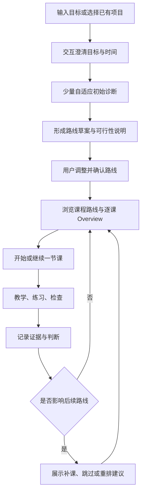

# UDT：交互诊断、课程路线与逐课 Overview 架构草案

状态：产品架构与首版实现说明；阶段 A-C 已落地，阶段 D 保留为后续工作。
日期：2026-10-18（2026-10-20 更新界面收敛与中文界面现状）。
代码基线：main `d7540b9`（含学习路线与中英切换）；版本号仍为 v0.1.1，这些功能尚未发布。
当前框架总览见 [`CURRENT-ARCHITECTURE.md`](./CURRENT-ARCHITECTURE.md)。

## 1. 这次要解决什么

用户希望：了解学习者的基本能力、使用场景、期限和目标程度，再制定从第一课到最后一课的路线；路线能以思维图或线路图浏览，每门课程/模块、每节课均可进入 Overview。参考 HyperKnow 的完整学习路径体验。

当前独立地图页只是把诊断树移到了一个主栏页面。它仍然是节点列表，也没有目标访谈、时间预算、模块、课次顺序或课程 Overview。增加入口和视觉装饰不能补齐这些能力。

本轮将课程路线定义为“有完整路线的自适应教学”，以目标、初始诊断、课程路线、逐课执行和证据反馈组成闭环。

## 2. HyperKnow 参考：已核查事实与设计提议

本次阅读了公开官网与官方指南，没有登录其应用，也未验证其登录后页面或内部实现。

- [官网](https://www.hyperknow.io/) 的公开定位为 “Turn any learning goal into a 1:1 AI course”，并列出基于课程、目标和学习方式的个性化，以及 guided study paths。
- [官方 3 Minute Guide](https://www.hyperknow.io/blogs/3-minute-guide-hyperknow) 明确支持从零建立 structured learning paths；在 “Learn something from 0 to 1” 中建议按目标建立计划，并通过 Deep Learning Session 更系统地学习。
- [官方 Study with AI](https://www.hyperknow.io/blogs/study-with-ai) 强调主动练习、定位误解和持续适应；不能把消费 AI 生成内容当成理解。

可借鉴的是：目标进入课程、课程有结构、学习有连续性，用户能提前知道自己要走向哪里。

下文的目标访谈、路线版本、双视图、节点模型与交互方案是为 UDT 设计的提案，不能当作对 HyperKnow 现有功能的描述。PDF、Canvas、视频、语音等不自动进入本轮范围。

## 3. 核心架构：一份项目，两张关联的图

### 3.1 课程路线图：我要怎么学

`LearningProject → CurriculumRevision → Module → CurriculumItem`

路线图拥有模块、课程顺序、先修依赖、目标能力、时间估计和阶段验收。初步诊断后，一次形成可浏览到终点的完整大纲；用户确认后成为当前计划。

未来课次允许只有 Overview，显示“已规划，尚未开课”。具体教学内容在开始该课时结合最新诊断生成。完整大纲并不要求预先生成所有课文、练习和答案。

### 3.2 知识诊断图：我现在会什么

沿用现有 `NodeRecord + Evidence`。它记录真正诊断到的知识点、先修障碍和实际观察。

每节规划课次可以覆盖多个知识点；一个知识点也可以在不同课次中被练习、检查和复习。不能把课次、知识点和一份课程正文强行做成一对一。

未来大纲中的主题可以先作为规划标签存在，不要求提前创建带诊断状态的知识节点。诊断到真实知识点后，再通过稳定 ID 关联。

### 3.3 两种状态需要分别表达

| 对象 | 表达的事实 | 不能推导的事实 |
| --- | --- | --- |
| 规划课次 | 已规划、可开始、进行中、已结束、根据诊断跳过 | 完成一课不能直接推导已掌握知识点 |
| 知识节点 | unconfirmed、explained、practiced、checked、weak、blocked、confirmed | 浏览、打开 Overview 或读完内容不能升级状态 |
| 时间估计 | 预计投入的区间、计算假设和剩余预算 | 到达某日期不等于已经掌握 |

如果显示课程进展，使用明确的事实计数，例如“已完成 4 / 16 节”；不要把它标为“掌握度 25%”。

## 4. 用户进入后的完整流程



### 4.1 目标访谈：交互式，允许说“不确定”

先利用用户已提供的信息，再补问缺失项。每轮一到两个问题，提供可选卡片和自由输入；可以返回修改和保存退出。

| 维度 | 交互示例 | 写入什么 |
| --- | --- | --- |
| 使用场景 | 考试、工作项目、面试、系统学习、自定义 | purpose、context |
| 目标程度 | 能解释 / 能独立做题或实现 / 能迁移到新问题 | 可观察的 outcomes 与验收任务 |
| 目标时间 | 指定日期 / 若干周内 / 暂无期限 | targetDate 或 duration，是否硬期限 |
| 时间投入 | 每周几次、每次多久，或每周总时长 | weeklyMinutes、sessionMinutes |
| 先验情况 | 学过哪些、用过什么、哪些不熟 | selfReports，不能写成已证实掌握 |
| 材料与偏好 | 课程范围、语言、练习形式、现有教材说明 | scope、preferences |

“精通机器学习”需要落实为“能够独立实现并解释某个模型、评估结果、诊断常见错误”等能力描述。入门/熟练/精通只作为访谈入口，不作为最终验收标准。

期限缺失时可以无期限学习，界面不能替用户填一个承诺日期。日期保存时保留时区；相对时长保存原始选择与起算时间。

### 4.2 初始诊断：为了选起点和范围

首轮建议三到六个短任务，按回答选择追问方向；这只是初始题量预算，不是声称几个题就能判断整个学科。已有可靠证据时不重复测试。

每个关键知识点区分：用户自述、实际观察、尚未核验。若信息不足但可以开始，显式标记相关假设，并把第一次核验安排在早期课次。用户可跳过初诊，但路线需显示“部分基础待核验”。

结果应解释：已观察到什么、哪些能力可利用、哪里可能需要补、哪些仍不确定。

### 4.3 路线草案与时间可行性

生成前结合目标程度、诊断结果、范围、每周预算和截止日期；预算包含讲解、练习、复习与阶段验收。

- 给出总投入区间和估算依据，不宣称按时必定掌握。
- 粗略可用预算为“可用周数 × 每周分钟数”，实际需处理起止周和用户不可用时间。
- 若目标与预算冲突，展示具体方案：保留期限并缩小范围、保留目标并延长期限、增加可投入时间。由用户选择。
- 先展示路线草案，再允许调整范围、节奏和重点，最后确认；用户看到的是可评估的方案。

一节课的时间可以拆成“核心讲解 15–20 分钟 + 练习与检查 15–25 分钟”，不把示例数字当作固定课时。

## 5. 页面架构与导航

侧栏保留两个主要入口，避免把所有对象都扩展成一个一级菜单。

```text
Learn
  当前学习项目
  当前课 / 继续学习
  与聊天并排的教学面板

Learning map
  项目 Overview
  ├─ 课程路线（默认）
  │   ├─ 阶段 / 模块
  │   └─ 每节课 → Lesson Overview → 开始或继续
  ├─ 知识关系（思维图）
  └─ 目标与时间设置
```

### 5.1 真正分开教学与浏览

上一轮新增了地图页入口，但地图和证据仍在日常教学侧栏完整堆叠。下一版应将完整地图与证据浏览集中到 Learning map；Learn 只保留当前课、下一步和一个简短的路线位置入口。

Start learning 应先确保目标/初诊/路线处于可开始状态；对已有项目优先显示“继续第 N 课”。打开 Overview 只浏览，不启动 Agent、不写 focus，也不标记完成。

### 5.2 项目 / 课程总览 Overview

展示目标成果、时间计划、已确认与待核验的基础、模块目录、从第一课到最后一课的顺序、阶段验收，以及当前建议起点。

在路线尚未确认时明确显示草案；用户可比较不同范围或节奏。已有项目尚无路线时显示“建立课程路线”，不能让原有诊断图消失。

### 5.3 模块 Overview 与每课 Overview

每个模块可展开课次，也可独立进入模块 Overview（能力目标、先修、课次清单、阶段验收）。

每课 Overview 至少包含：

- 稳定课次 ID、显示序号、标题、所属模块。
- 本课用途：它怎样推进用户的最终目标。
- 学完能够做什么：一到三个可观察结果。
- 先修条件、当前已核验情况，以及推荐补课入口。
- 具体内容小节，预计投入区间。
- 练习任务与验收方式，不提前泄露检查题答案。
- 关联知识点、相关证据入口、上课记录。
- 前后课入口，以及“开始 / 继续 / 复习”。

未来课程均可进入 Overview，即使暂时不推荐开始。用户选择越过先修时说明原因和可选择的短诊断，不用强制锁定阻止浏览。

### 5.4 课程内学习

正文、示例、可视化、练习、检查继续使用现有教学面板；顶部只显示当前位置，例如“模块 2 · 第 5 / 18 课”。

同一课可有多个教学单元和多次尝试。一次重讲不能覆盖早期作答、证据和已学内容。

## 6. 可视化必须表达什么

### 6.1 路线图：默认视图

模块分组、明确的开始和终点、课次编号、有方向的先修线，当前课居中突出。默认给出从第一课到最后一课的推荐顺序，能折叠远期模块并展开全部。

实线表达必需先修，虚线表达可选支线/扩展；图例说明线条含义。一个课次可以有多个先修。先修依赖构成 DAG，显示顺序独立于创建时间。

支持点选查看 Overview、缩放、平移、适应窗口、回到当前课、按模块折叠与搜索。窄侧栏提供章节清单，主页面提供完整画布。

### 6.2 知识思维图：关联视图

以概念和能力为节点，显示已经记录的状态和证据；点选概念后能看到关联课次。规划中的未诊断主题明确标记为“待核验”，不能凭大纲自动赋予 explained / confirmed。

概念层级与学习先修是两种边：不能把当前 `parentId` 无条件解释成课程先后关系。

### 6.3 图与清单来自同一份模型

画布与可访问的章节清单共同使用同一份课程版本；屏幕阅读器和键盘用户能够打开任意课次。状态还需文字/图标表达，不仅靠颜色。

布局不应在每次轮询时随机重排；稳定 ID 维持选择和视口。布局坐标只是展示数据，不参与课程逻辑。

图形库选型需先验证 DSH 的单文件 classic bundle、React 共用实例、CSS 注入及性能约束。可以评估 SVG + DAG 布局器，或在这些条件通过后再采用 React Flow；不依赖 CDN 或未经验证的动态分包。

## 7. 数据模型建议

现有 `CourseRecord` 实际代表整个学习项目，保留其 `courseId` 兼容语义。不要又引入一个同名“课程”去承载模块或单节课。

| 新对象 | 最小责任与关键字段 |
| --- | --- |
| GoalBrief | projectId、purpose、targetOutcomes、deadline/duration、timeZone、weeklyMinutes、sessionMinutes、preferences、revision |
| AssessmentRun | projectId、sessionId、目标简报版本、题目/回应引用、证据引用、已观察/自述/待核验结论 |
| CurriculumRevision | projectId、revision、basedOnBriefRevision、basedOnEvidence、draft/accepted/superseded、assumptions、估时、变更原因 |
| CurriculumModule | 稳定 moduleId、所属版本、标题、能力目标、阶段验收 |
| CurriculumItem | 稳定 itemId、moduleId、顺序、Overview、目标、规划主题、已关联 nodeIds、估时、验收标准 |
| CurriculumEdge | 所属版本、fromItemId、toItemId、required/optional；required 依赖禁止环 |
| LearningRun | projectId、sessionId、固定的课程版本、currentItemId、focusNodeId、attemptId |
| LessonAttempt / TeachingUnit | 课次、尝试、节点及现有 LessonRecord 的关联/快照引用；记录当时计划版本和教学内容 |

关键区别：`CurriculumItem` 是一节计划课，现有 `LessonRecord` 是针对节点的教学区块内容，两者不能共用同一个 ID 语义。

v0.2 的持久化方案必须先验证 DSH Storage Domain 的升级方式，再落地新增规划记录；不能直接增加版本号使所有现有 v1 文档打不开，也不能假设平台会自动迁移。优先维持单一有序写入边界和完整导出能力；如必须使用独立规划 domain，需要明确关联删除、重试、导出和中途失败恢复策略。

## 8. 工具、教学协议与运行时边界

这是能力扩展，需要同时更新插件工具说明和教学协议，不只是改 UI。

当前协议明确说：`udt_goal_create` 只创建目标和一个根节点；`udt_map_update` 仅增加诊断实际揭示的节点，最多每次 8 个、总计 40 个。不能为生成完整课程而绕过这些限制、重复批量塞入大纲。

建议增加独立的目标简报、诊断汇总和路线读写能力（以下是拟议 API，不是现有工具）：

- `udt_goal_brief_get/update`：保存目标、预算与偏好，附带版本和未决问题。
- `udt_assessment_get/update`：记录初始诊断过程与结论，引用实际证据。
- `udt_curriculum_get/propose`：生成/修改路线草案，包含整个可浏览大纲和所有课次 Overview。
- 用户确认路线走应用端 accept action；模型不能自行把草案改成“用户已确认”。
- `udt_course_item_get` / begin action：浏览课次与开始学习是两种操作。
- 现有 `udt_map_update`、`udt_lesson_update`、`udt_decide_next` 保留诊断、教学及下一步判断职责，逐步加上可选课次上下文。

Agent 提议教学路线与下一步；运行时验证结构、预算输入、引用和版本，持久化并呈现；用户决定接受计划和开始/继续学习。运行时不凭固定分数替代教学判断。

新工具不可用时应继续现有诊断教学，不能在聊天里宣称已经生成或保存了课程路线。

## 9. 学习中怎样调整路线

- 已掌握某先修：推荐跳过或快速验收，保留原因与证据。
- 发现基础障碍：插入一节补课，并显示影响到的后续课次和时间估计。
- 用户改变期限或投入：先修改目标简报，再给出新路线草案和范围/时间变化。
- 阶段验收未达到：调整后续计划，而不是仅因为“学完所有课文”就宣布掌握。

路线的重大范围、目标或时间变化需展示差异并让用户确认；课内的小练习和既有继续动作不应每次都弹出计划审批。

课程版本需要保留：已完成课次和历史证据不能因为重排而消失。稳定 itemId 维持身份，课次序号只是当前显示顺序。

## 10. 并发与原有会话隔离

规划和知识属于项目；当前执行位置、作答和 handoff 属于具体会话。LearningRun 固定课程版本，其他会话接受新路线时不得自动把当前会话挪到另一节课。

所有规划写入使用预期 revision；晚返回的旧结果不能覆盖用户刚修改的预算或选课。Start / Continue 带 sessionId、projectId、itemId、revision 和幂等操作 ID。

继续学习本身也遵守会话隔离：项目库和“Open current lesson”通过只读的 `/project/session` 解析该项目最近活跃的会话（active focus → 有尝试的 course run → 最近项目选择），再用宿主 `uiWorkspace.openSession` 切过去并打开停靠标签；只有项目从未被任何会话触碰时才回退到当前会话。

浏览别的课程 Overview 不得改变当前学习位置；改选项目、接受新版本、开始课次分别是显式行为。打开页、画布选择和展开模块都不应创建学习证据。

## 11. 实现顺序与验收

### 阶段 A：目标与初诊模型

交互式目标卡、初诊记录、可修改的预算与可观察目标。先在本地预览/隔离 profile 验证，不碰真实 learner data。

验收：恢复中断访谈；已知信息不重复问；自述不冒充证据；预算冲突有可选方案。

### 阶段 B：完整大纲、项目/模块/每课 Overview

先完成路线版本、草案确认与逐课浏览，图形版和列表版使用同一模型。所有课次 Overview 可浏览，未生成正文也能正确显示。

验收：从第一课浏览到最后一课；进入任意 Overview 不写 focus；旧项目没有路线时可继续原有教学。

### 阶段 C：线路图/思维图与真实课次执行

加入可缩放路线画布、模块折叠、当前课定位、从课次开始教学以及返回聊天。连接现有诊断和教学面板。

验收：多先修 DAG 不成环；画布与清单一致；键盘可操作；窄侧栏/深浅色/滚动通过；每次点击唤醒正确会话。

### 阶段 D：证据驱动改路线与迁移验收

复习、补课、跳过、新版本差异及时间重估。迁移、导出、删除和失败恢复完成后再考虑发布。

验收：两会话互不抢课；同课多次尝试可追溯；通过正文阅读不升级 mastery；目标变化后旧版本和证据仍可查；没有时间承诺式“自动精通”。

## 12. 首版落地与保留项

阶段 A-C 的首版已在独立课程模型上实现：可保存部分目标草稿、发起 tutor 初诊或显式跳过、保存带证据引用的 assessment、生成并确认版本化路线、浏览项目/模块/全部课次 Overview、从明确确认的路线开始逐课教学。Learning map 提供路线画布、顺序清单和原诊断证据图；Learn 面板显示当前尝试与已保存教学。旧 v1 存储通过新增表兼容，不执行迁移或覆盖旧数据。

界面引导（2026-10-24）：路线页以“下一步”卡片作为唯一引导入口，按阶段只给一个主操作，
次要动作仅在确有替代时出现；初诊与路线阶段的重复动作收起，空态与等待卡并入下一步文案。
规划写入使用 revision 和 operation ID；路线计划与知识诊断仍是不同事实。并发 append、会话隔离、过期 attempt、证据来源、存储引用和导出/重置均有自动化回归。首版没有自动判定课程完成等于掌握，也不在用户确认前开始课程。

阶段 D 部分实现：每课开始提示 Agent 在完成后对照新的检查/迁移证据与剩余先修、目标和预算；只有路线假设实质变化时才提出带原因的新版本，且仍须学习者确认。尚未自动建议跳课/补课、展示版本差异或完成跨课程迁移验收。

首版验收：568 个 Vitest 测试、TypeScript 检查、生产构建通过；path browser fixture 在浅/深色与 1440/900/400 宽度下通过 24 组交互场景，地图页、全屏面板和侧栏视觉审计均无发现。将包安装到 DSH `0.2.1-rc.2` 的全新 `/tmp` profile 后，Learning map 正常挂载，目标草稿保存和显式跳过初诊均经真实 HTTP API 持久化；未登录提示按预期出现并被关闭，没有调用 Agent。全程没有访问或修改真实学习者数据。

界面收敛（2026-10-20）：Learning map 成为唯一主栏页面，Current lesson 停靠标签成为唯一教学表面；独立的全屏学习面板不再注册（仅保留给预览与测试），地图页的“Open current lesson”改为返回对话并打开停靠标签。中英切换现在覆盖全部插件页面：地图页、路线页、课程/课次面板、停靠标签、独立全屏面板、下一步卡片、等待提示、欢迎行与侧栏 Learn 入口；只有侧栏固定注册的 Learning map 标签、宿主动态 handoff 详情和开发预览工具栏仍为固定文本。最新数字：607 个 Vitest 测试、24 组浏览器场景（每组都验证中英切换）、地图与面板视觉审计无发现；详见 CURRENT-ARCHITECTURE.md。
