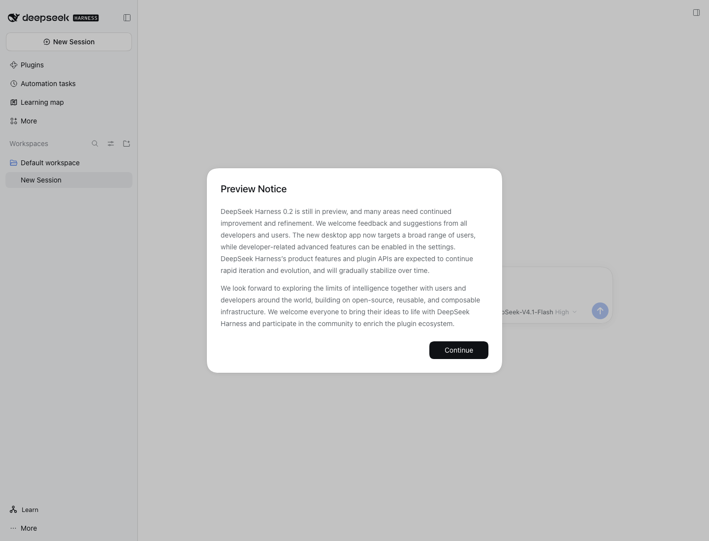
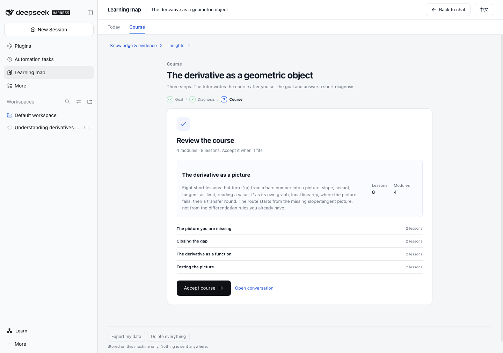
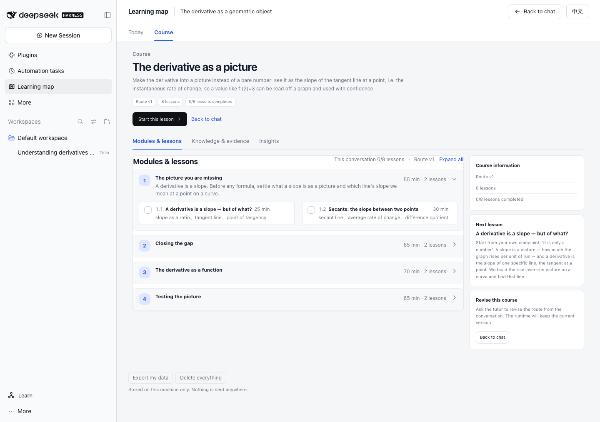

# v1.0.0 First-Run E2E

Environment: isolated DSH_HOME, DSH 0.2.2-rc.1, DeepSeek-V4.1-Flash,
Universal Diagnostic Tutor skill copied into a temporary workspace
`.agents/skills/`, diagnostic-tutor 1.0.0 candidate package.

## Actual flow

1. Fresh profile had no learner state (`courses=0`).
2. DSH Preview notice required one **Continue** click before the composer accepted
   input. This is a DSH host surface, not a tutor bug; the installer docs mention
   it as a first-open step.
3. Real Tutor loaded the skill and called `udt_status` / `udt_goal_create`.
4. Goal: **The derivative as a geometric object**.
5. Real diagnosis: nodes and readiness evidence; course route proposed with 8
   lessons in 4 modules.
6. Learner accepted the route in Course → **Accept course**.
7. Course page showed route v1, 8 lessons, 0/8 complete, first lesson.
8. Tutor wrote the first lesson and asked a real visual check question.
9. Scripted learner answer: tangent rises about 1 over 1, slope about 1; at x=3
   steeper.
10. Tutor recorded **check evidence** on
    `derivative-slope-of-the-tangent-line-ins...`; node state became `weak`.
11. Tutor recorded `udt_decide_next` **review-first**.
12. Export/import API round trip:
    - exports 1 course / 3 nodes / 1 lesson / 1 path;
    - imports the same document successfully;
    - counts remain intact.

Screenshots:

## Classification

**Complete Pass for first-run engineering E2E** with a **scripted learner**.
Real learner participants: **0**. Independent education review: **0**.

Not completed in this session: full Study block interaction after the route
acceptance; the existing 0.13 Study/control E2E covers that surface. No claim of
learning gains.
