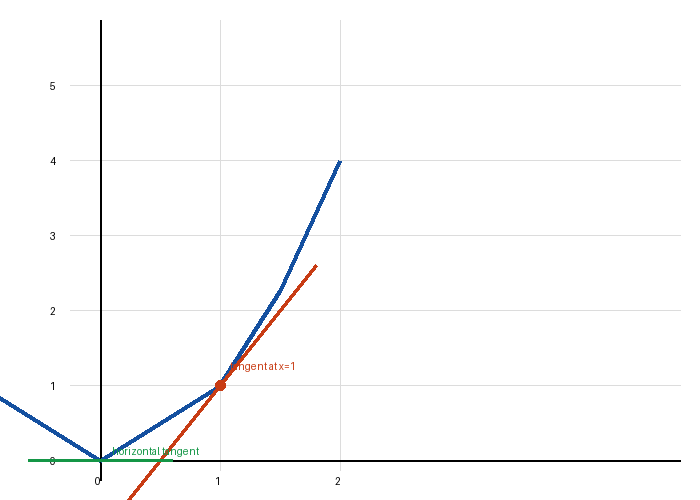
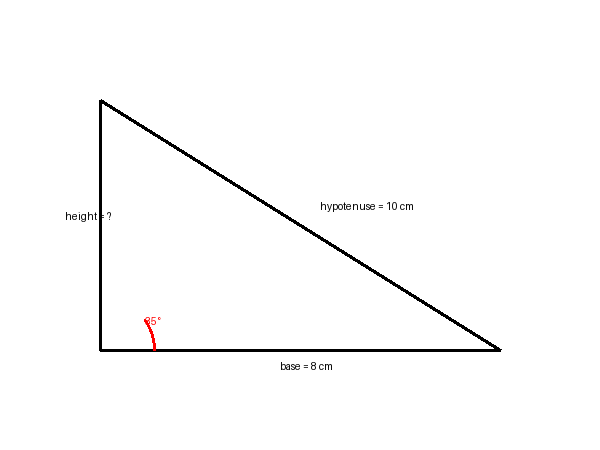
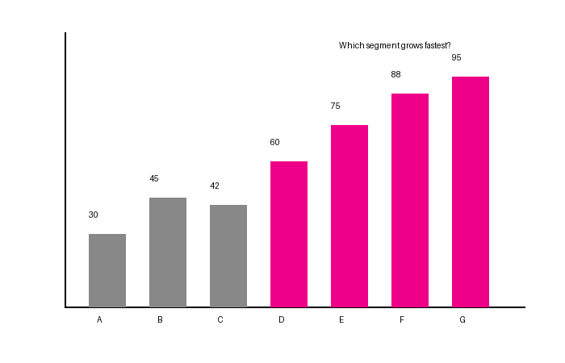

# v1.1.0 Multimodal Materials — Actual Findings

## Host capability (DSH 0.2.2-rc.2)

rc.2's DeepSeek LLM adapter declares `inputModalities: ["text", "image"]`, and the
host persists image attachments as verified content-addressed files. The agent
receives the attachment through host image/file tools. This is **not OCR**.

A real test with a generated graph (`math_graph.png`) asked for the horizontal
tangent and the orange tangent's slope. The model read the image, performed
pixel/geometric analysis with local tools, and answered **x=0, slope=2**, both
correct. The trajectory showed image reading and pixel inspection, not OCR or a
filename guess.

## Image test cases

| Case | Status | Result |
|---|---|---|
| A math graph (y=x², tangent at x=1, horizontal at x=0) | executed | correct x=0, slope=2 |
| B geometry (base 8, hypotenuse 10, marked 35°) | executed | identified 35° as inconsistent with 6–8–10 (36.87°) |
| C bar chart (A–G, color change at D) | executed | correct C→D fastest and color change at D |
| D handwritten notes | prepared; not executed | not claimed |
| E low-quality/rotated image | prepared; not executed | not claimed |

These are **tool-mediated visual readings**, not proven native-token-only vision.
The model used local pixel analysis in these runs. No OCR was involved.

## Runtime material bridge

- `udt_material_visual` returns the exact content-addressed path and an explicit
  caveat: a path is not visual understanding; the host agent must read it.
- It does not call OCR or any third-party service.
- No persisted image-analysis field was added, preserving 1.0.2 storage readability.
- Upload/display/visual access never write mastery or check evidence.

## Skill contract

The Skill distinguishes image display/metadata, tool-mediated visual access,
OCR derived text, model interpretation and learner evidence. It must admit when
it cannot see an image or when a PDF page has no native text.

## PDF findings

- Native PDF text extraction is the only PDF text source.
- A scanned one-page PDF produced an empty page and is explicitly reported as
  no native text layer. It is **not OCRed** and no text is invented.
- Page citations remain original 1-based pages.
- Charts/tables/figures are not generally understood from PDF native text.

## Remaining gaps

- No OCR library is bundled; scanned PDFs need a future OCR adapter.
- No PDF page-image/figure-region extraction.
- The observed Tutor created a goal, diagnosis and a lesson containing the
  uploaded image, but did not complete a route/check in that session.
- Real learner and independent education review remain 0.

## Evidence files

A plugin-stored image was later read through `udt_asset_list` +
`udt_material_visual`: the Tutor reported the actual pixels and answered x=0 /
slope=2. This is the material bridge, not merely a display check.
