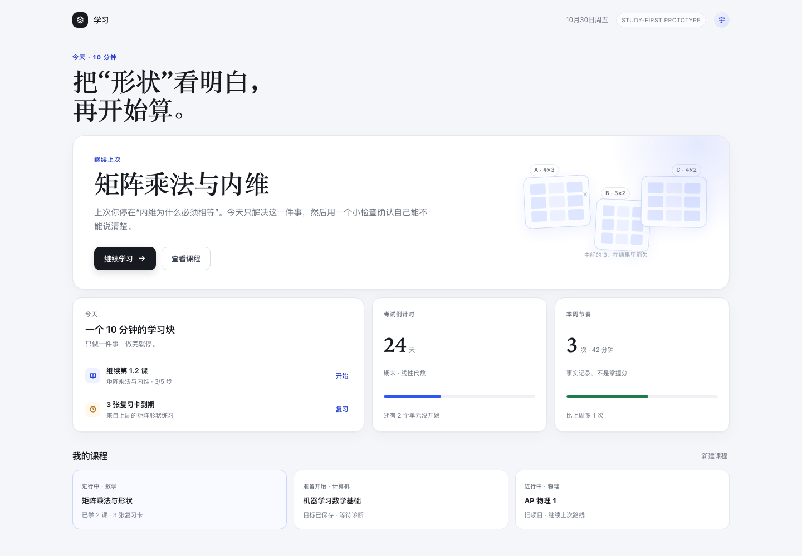
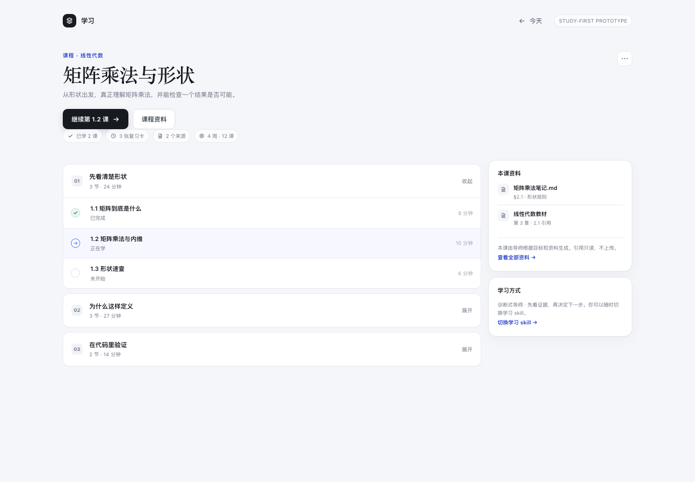
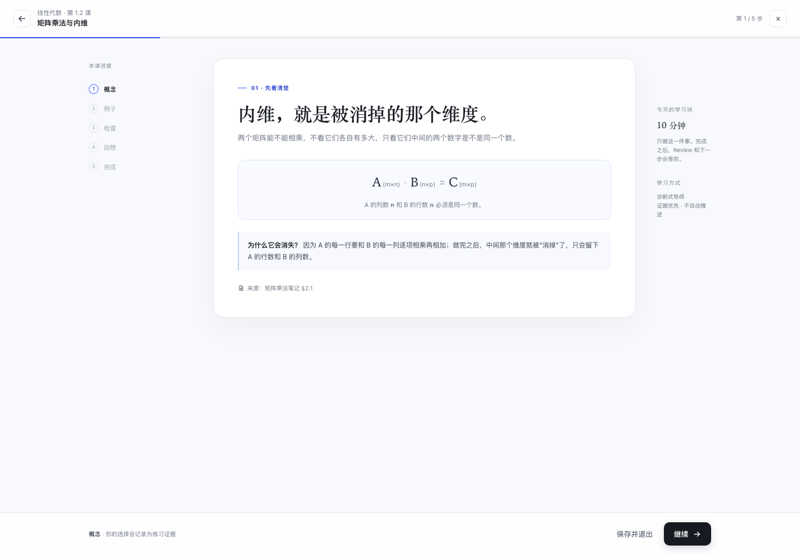
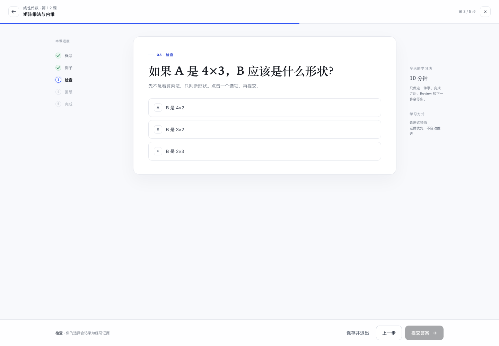
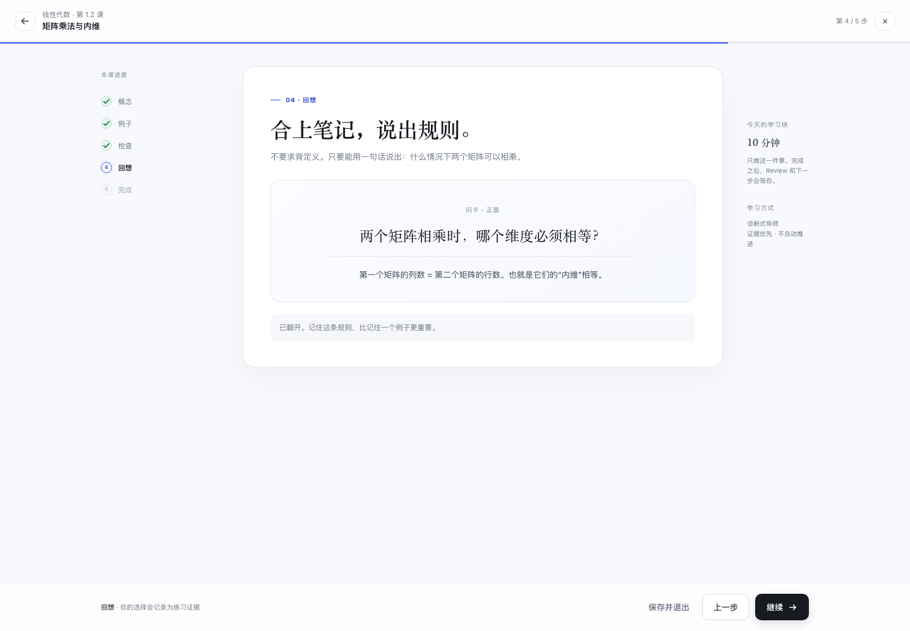
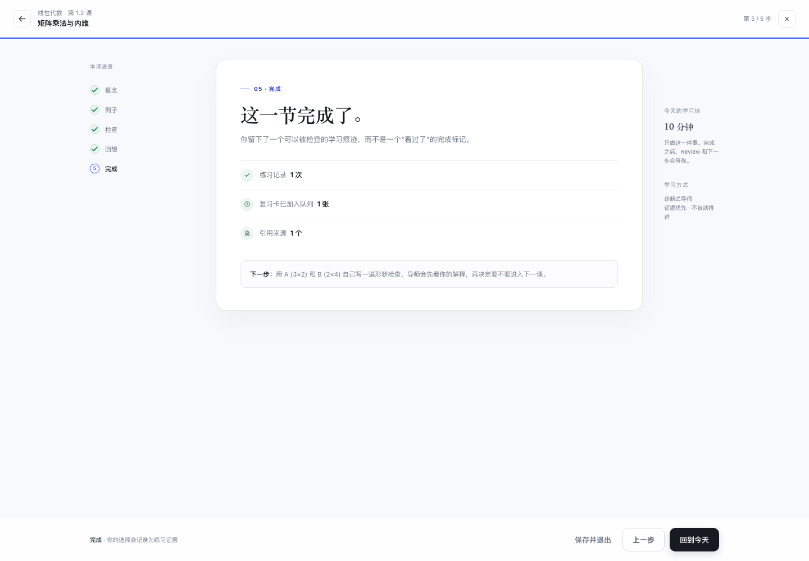

# Study-first UX prototype

一个不依赖真实存储和后端的可点击原型，用来先确定新的产品主脊，再动生产插件。

## 打开

```bash
pnpm preview
# http://127.0.0.1:8391/preview/next/index.html
```

可以直接用 URL 看某一屏：

- `?screen=home`
- `?screen=course`
- `?screen=study&step=0`（概念）
- `?screen=study&step=2`（检查）
- `?screen=study&step=3`（闪卡）
- `?screen=study&step=4`（完成）

## 预览

| Home | Course |
| --- | --- |
|  |  |

| Study · 概念 | Study · 检查 |
| --- | --- |
|  |  |

| Study · 闪卡 | Study · 完成 |
| --- | --- |
|  |  |

## 三屏结构

### Home / 今天

只回答“今天这 10 分钟做什么”：

- 一个主按钮：继续学习
- 复习到期数量
- 考试倒计时
- 本周节奏（事实记录，不是掌握分）
- 课程列表

没有四个 tab，没有目标表单，没有多个同级按钮。

### Course / 课程

- 课程目标、资料、已学事实
- 模块与课次列表
- 一个主按钮：继续第 1.2 课
- 资料引用以 side card 呈现，不新开 tab

### Study / 学习

专注模式，不显示 Learning map 或侧栏：

- 顶部：返回、课程、步骤、退出
- 左侧步骤轨（桌面）
- 中间单一内容卡：概念 → 例子 → 检查 → 闪卡 → 完成
- 底部固定操作条：保存并退出 / 上一步 / 一个主动作
- 选择答案后只记录练习证据，不显示分数、不自动判对错
- 完成页明确记录“证据 / 复习卡 / 来源”，而不是“完成百分比”

## 这个原型刻意没做

- 真实课程生成/资料上传（下一片）
- Review 独立流程（从 Home 进入，不做第四个 tab）
- Insights（作为课程二级页面）
- 真正的后端状态、权限、持久化

## 生产映射建议

| 原型 | 生产实现 |
| --- | --- |
| Home | 新的主面板首页，替换四个 tab 并列 |
| Course | 课程/路线页面；保留路线数据，隐藏内部 goal/assessment 术语 |
| Study | 右侧 lesson tab 或全屏聚焦页面，复用现有 block 与 interactions |
| 复习 | 从 Home 卡片进入，不再作为一级 tab |
| 资料 | 复用 sources / sourceRefs，后续增加文件输入 |

目标是先让“今天学什么 → 学完留下什么”变成一条一眼能看懂的路径；课程生成、Review 流程和 Insights 的二级化在后续切片完成。
