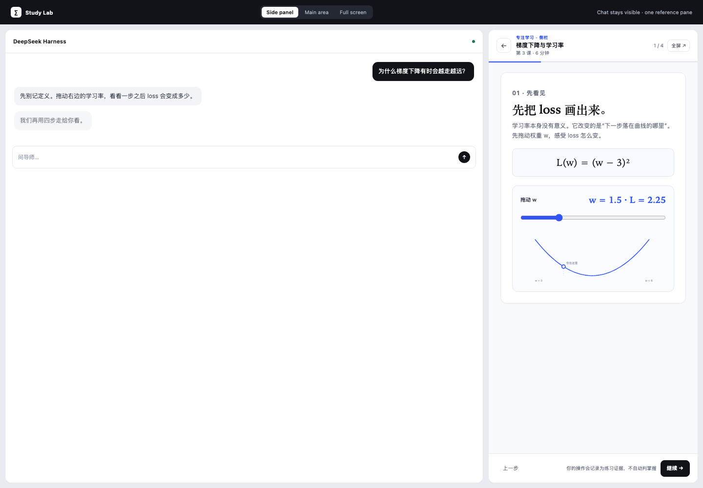
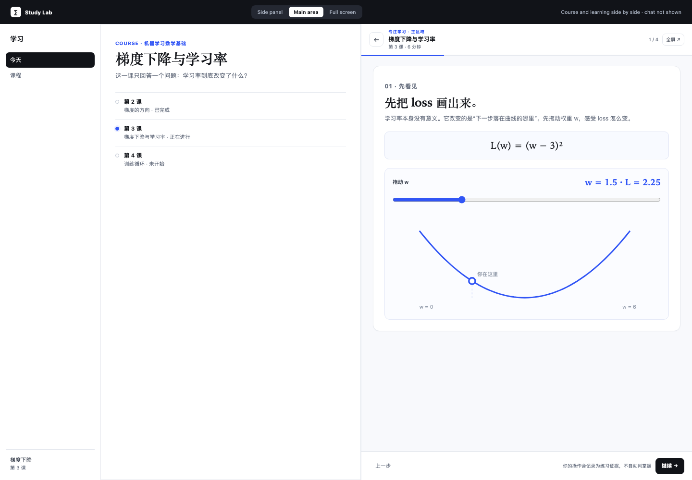
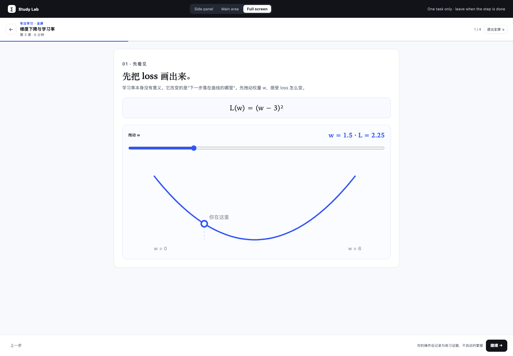
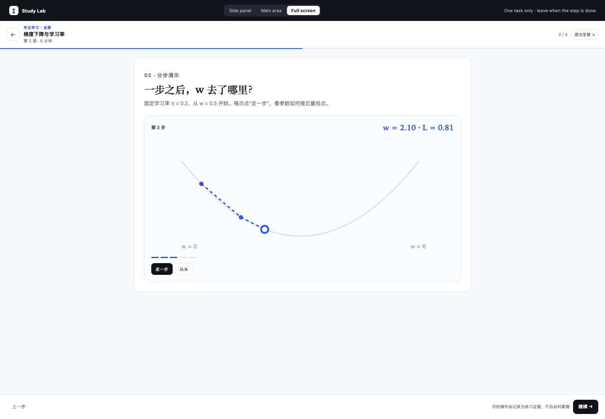

# Study Lab

A clickable study-surface prototype for the three layout modes and stronger interaction.

```bash
pnpm preview
# http://127.0.0.1:8391/preview/study-lab/index.html
```

## What to try

1. Switch **Side panel / Main area / Full screen** in the top bar.
2. Drag the **w** slider and watch the loss point move.
3. Go to step 2 and click **走一步** to follow four gradient-descent updates.
4. Go to step 3, choose an option and submit — the note records the choice without grading.
5. Use **全屏 / 退出全屏** inside the study header; exit back to the course.

## Layout rules

See [`docs/design/study-layout.md`](../../docs/design/study-layout.md).

- Side panel: conversation + one reference pane
- Main area: course + study, conversation not shown
- Full screen: one task only; explicit toggle/exit

## Screenshots

| Side | Main | Full |
| --- | --- | --- |
|  |  |  |

| Slider interaction | Step-through |
| --- | --- |
|  |  |

## Scope

This is a design prototype, not production. It uses inline SVG/CSS and fixture data only; it makes no network requests. The production Study renderer still uses `StoredBlock` and `BlockInteraction`; slider/step-through widget schemas are the next production slice.
